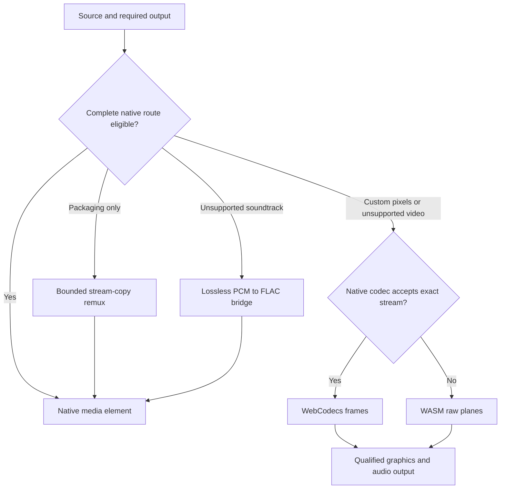

# Universal Browser Video Engine v8.0

## HDR10, native handoff, software fallback and evidence-based qualification

**Revision:** 25 November 2026, Asia/Shanghai. Research baseline checked 24 November 2026; raw experiment times remain UTC.  
**Product:** A browser-only playback SDK and Vue reference player, delivered as static assets.  
**Primary requested combination:** 3840×2160 AV1 Main profile, 10-bit 4:2:0, valid HDR10, conventional TrueHD channel audio, and complex subtitles.  
**Hard performance targets:** at least 60 unique source pictures/s in full quality and at least 120 unique source pictures/s in an explicitly defined performance mode.  
**Current release verdict:** **NOT QUALIFIED for the complete requested combination or universal format/platform claim.** The work below supplies implemented experiments, verified component improvements, a revised architecture and an executable qualification system. It does not turn omitted hardware tests or component throughput into a complete-player pass.

### Authority and scope

This revision follows the user's latest instruction: **HDR10 replaces Dolby Vision as the primary HDR requirement.** Dolby Vision is an optional extension with independent metadata and rendering requirements. Its unverified state no longer blocks HDR10 work. The user also requested extreme cases in which source video, audio, subtitles and packaging all require managed handling. The corpus supplies bounded fixtures for that managed baseline, plus explicit tests of invalid or version-dependent mappings. Running these fixtures with browser-native decoders disabled establishes the selected managed experiment; it does not prove that every inner codec lacks native support on every platform. Native availability remains an exact-platform admission question.

Native codec and WebGPU performance testing are deferred at the user's request because this environment has no suitable GPU. Research, exact interface/source review, CPU/WASM experiments, signal generation, PCM/pixel validation and qualification tooling are performed where available. A deferred test has status `DEFERRED_NOT_QUALIFIED`; it is neither an observed failure nor a pass.

The v7 implementation starter remains a core-contract foundation, not an already playable production SDK. This revision retains the I00–I12 task identities, changes their priority and adds concrete AV1/HDR10/TrueHD/subtitle exits. It supersedes the old ProRes-first execution priority and any obsolete package pin. The complete v7 document is retained as historical evidence in the accompanying archive; its measurements keep their original scope and do not become v8 AV1 measurements.

### What “full” and “performance” mean

| Requirement | Full quality, 60 | Performance mode, 120 |
|---|---|---|
| Source workload | A genuine 60/1 fps source with unique picture opportunities | A genuine 120/1 fps source with unique picture opportunities |
| Video decode | Every required source picture, reference dependency, bit depth and chroma component | Same unless an explicitly supported scalable operating point or reduced decode is separately identified |
| HDR | Correct PQ/BT.2020 interpretation, preserved static metadata and admitted HDR output mapping | A named transform; HDR may remain intact, or an explicitly chosen reduced output mapping may apply |
| Spatial quality | Preserve source detail to the admitted output; no hidden lower-resolution intermediate | Explicit video output downscale and/or subtitle raster cap can be selected |
| Temporal quality | No deliberate drops, repeats counted as new frames, or interpolation substituted for source pictures | Still 120 unique source pictures; dropping to 60 cannot satisfy this target |
| Audio | Decoder-domain exact conventional TrueHD PCM; all output transformations identified | Retain exact decoded source PCM unless a separate user-visible output policy specifies a transform |
| Subtitles | Required text, fonts, shaping, positioning, effects, timing and forced cues | Text, cue timing and forced status retained; permitted raster/effect changes declared individually |
| Presentation | Exact inline/fullscreen/PiP/output route qualified | Same requirement at the selected reduced transform and 120 rate |

A 24 fps movie shown on a 120 Hz display still contains 24 unique source pictures per second. Decoder throughput, frame submissions, render callbacks and physical presentation are separate quantities. Likewise, the current 60/120 goals are not satisfied by running a 30 fps source at 2×/4× playback speed. Fractional rates, interlace and VFR are separate cadence profiles.

“All possible” resolutions, codec profiles, subtitle programs and bitrates cannot be enumerated or guaranteed on every device running a current OS. Some combinations are invalid; some codecs have fixed raster/rate limits; valid subtitle work and lossless input bandwidth can grow beyond any finite machine. This plan preserves the requested thresholds as hard admission targets and exposes the exact tested subset. It does not silently redefine unsupported or untested configurations as passing.

## 1. Decisions supported by this revision

1. Prefer a complete native media-element path whenever it preserves the required video, audio and output behavior. Keep encoded AV1/HDR10 and native video surfaces intact as far through the pipeline as possible.
2. If the soundtrack blocks native playback, investigate a **lossless TrueHD → exact PCM → FLAC/fMP4 bridge** while leaving video access units unchanged. The measured batching optimization in this revision lowers bridge CPU/RPC work while retaining PCM. The combined native route still requires device qualification.
3. Keep ASS/PGS rendering over native video when the selected output mode can retain the overlay. Special subtitles do not automatically require software video decoding.
4. Use WebCodecs for browser-provided decode when custom composition is necessary. Use WebGPU for qualified color conversion, scaling and composition. WebGPU is a graphics/compute API, not a standardized interface to the fixed-function AV1 decoder.
5. For genuinely unsupported source codecs, use a packet-fed, bounded WASM adapter. Test a dav1d SIMD/atomic candidate against the libaom WASM baseline with identical compressed input and visible output bytes. Do not infer WASM speed from native dav1d/x86 assembler benchmarks.
6. A 10-bit output path must carry all 16-bit storage bytes and the correct visible row strides. The discovered half-sized `video_packed` copy is excluded from valid performance evidence.
7. Keep the conventional TrueHD channel claim separate from Atmos object rendering and encoded-bitstream passthrough. An exact 24-bit FLAC bridge preserves the tested PCM, not TrueHD/Atmos metadata semantics.
8. Treat subtitle complexity, decoder reference surfaces, compressed peak bitrate and index expansion as separate resource dimensions. A single “4K supported” flag hides the actual limits.

These are implementation decisions, not a claim that the complete production player or platform qualification has been completed.

## 2. Route selection and native handoff

### 2.1 Ordered routes

| Route | Data flow | Use when | Required admission evidence |
|---|---|---|---|
| N0: direct native | File/eligible URL → one media element | Browser accepts the selected container, video and soundtrack, with required output semantics | Exact track/profile/output support; subtitles and controls survive the output mode |
| N1: native after remux | Incremental demux → stream-copy fragments → MSE/MMS → one media element | Packaging is the obstacle; selected codecs are already accepted | Packet/configuration/HDR retention, exact timing/edits/priming, valid destination mapping |
| N2: lossless audio bridge | Unchanged video + TrueHD WASM → exact PCM → batched FLAC → fMP4 → one media element | Native HDR video is available, source TrueHD is not, and the destination accepts the actual AV1+FLAC combination | Full PCM/channel/timing correctness plus native combined playback and output qualification |
| N3: native video with separate PCM | Muted native video + TrueHD producer → AudioWorklet | N2 is unavailable and this hybrid has demonstrated a real advantage | Two-clock start, drift, seek, pause, rate, interruption and recovery tests |
| C0: native decode with custom graphics | Demux → WebCodecs `VideoDecoder` → WebGPU; audio via native or managed route | Pixel composition is necessary and native decode is accepted | Correct native frame format/color state, graphics output and lifetime; complete combined measurements |
| C1: managed source decode | Demux → WASM planes/PCM/subtitle state → native output primitives or WebGPU | The source codecs genuinely lack a usable native path | Correct decoder output; bounded memory/queues; complete-pipeline and output evidence |

Route choice is based on exact codec strings, profile/level, sample configuration, metadata, required output mode and qualification records. `canPlayType`, `isTypeSupported`, `isConfigSupported` and MediaCapabilities provide useful capability evidence, not guaranteed performance or fidelity. Hardware preference is a hint; “browser-native decoder” and “hardware decoder” remain separate recorded fields. [P02, P32]



The diagram omits N3's two-clock hybrid for readability. It is a separately qualified route, not an automatic fallback hidden inside N2. Subtitle overlays can accompany N0–N3 where inline/document-fullscreen behavior is eligible.

### 2.2 What native components can take over

The browser can own media-element decode/scheduling, native video surfaces, supported audio codecs, output resampling/mixing, volume/panning, compatible WebVTT, graphics scaling and color conversion, and synchronization inside one native media pipeline. The SDK still owns unsupported container parsing, codec extensions, exact metadata retention, advanced subtitle semantics, admission and observable recovery.

For a completely managed source tuple, native handoff can still begin **after** source decode. For example, FFV1 planes can be uploaded to a qualified graphics path; decoded DTS/TrueHD PCM can feed an AudioWorklet; ASS masks can be composited by the GPU. These operations do not misrepresent the original unsupported source formats as natively decoded.

Browser JavaScript cannot directly call arbitrary VideoToolbox, MediaCodec, Media Foundation, installed DLLs or a native FFmpeg process. Electron, native messaging, an installed helper or a transcoding server would change the browser-only deployment contract and are not silently introduced here. [P02, P03, P57, P58, P59]

### 2.3 Copy and ownership policy

Avoid native-frame readback into JS merely to draw the same frame again. Prefer media-element surfaces or an admitted external-texture import. The specification permits implementation-dependent copies, so use “avoids explicit readback” until traces establish a physical zero-copy path. Keep original raw planes when a custom HDR decoder needs them; an external texture is not an API exposing untouched Y/Cb/Cr storage. [P01]

One selected-track coordinator owns the source and compressed cache. Decoder workers own codec instances. Every packet, frame, PCM block and GPU resource has one releasable owner, a generation and a finite lifetime. Reserve bytes and queue slots before allocation or submission. A transferred buffer moves its lease; popping a queue does not release the allocation. Raw frames and PCM never enter Vue reactive state.

The native path has opaque buffers as well as application-owned ones. Report explicit bytes, process/realm measurements and opaque estimates separately. A JavaScript ledger cannot enforce an arbitrary third-party WASM heap limit or precisely count browser-retained video surfaces.

### 2.4 What “WebGPU decoding” can mean

The selected accelerated path is browser/native decode followed by WebGPU processing of decoded frames. WebGPU exposes general graphics/compute work and external-texture import; it does not expose a standard compressed AV1 decode command. Custom WGSL implementations of codec stages are a separate research effort requiring exact reconstruction, reference-frame management, synchronization and input-parallelism analysis. No measured 4K60/120 benefit is assigned to an unimplemented GPU decoder. [P01, P02]

Research also checked newer projects advertised as WebGPU-accelerated FFmpeg. For example, the current [wasmpeg documentation](https://github.com/wasmpeg/wasmpeg) describes WASM decoding with GPU scaling and a high-level RGBA8 frame API. That is useful processing research, but that documented API does not establish preserved 10-bit HDR or a GPU AV1 entropy decoder. It is not selected as a full-quality replacement without an independently validated high-depth path. Chrome's [WebGPU migration guidance](https://developer.chrome.com/docs/web-platform/webgpu/from-webgl-to-webgpu) supports the narrower WebCodecs-frame/import/processing architecture.

Prioritize zero-readback native surfaces, fused color/scale/composite operations, changed subtitle masks and bounded GPU work submission before an entirely new compressed-video shader decoder. Native/GPU timing remains deferred here, as requested.

## 3. HDR10 fidelity and color processing

### 3.1 Preserve the source descriptor

The owned track/epoch descriptor carries bit depth, chroma subsampling/location, matrix coefficients, transfer, primaries, range, mastering-display chromaticities/luminance, content-light information, source provenance and any conflict between container and bitstream signaling. Retain the original AV1 metadata OBUs and packet bytes when stream copying. Validate metadata after each demux/remux boundary, not only on input.

Mediabunny 1.66.4 exposes useful basic color information, but its inspected Matroska/public color path is not a complete mastering-display/MaxCLL/MaxFALL contract. AV1 in-band metadata can remain in encoded packets; that fact does not prove the SDK parsed, retained or exposed every static-HDR field. I02 therefore owns an explicit metadata adapter and regression fixtures. An unknown or conflicting value stays unknown/conflicting until a documented interpretation policy resolves it.

The mathematical test corpus in this revision generates actual PQ/ST 2084 signals and BT.2020 nonconstant-luma 10-bit planes, rather than retagging SDR values. Gray/chroma patterns, low-bit witnesses, moving markers and source frame IDs are retained. Mastering and content-light metadata are encoded and checked in decoded AV1 side data. These original synthetic patterns are not a certified HDR10 conformance suite. AV1 encoding is declared lossy, so decoder comparison uses an independently decoded reference for the actual bitstream, not equality to pre-encode pixels.

### 3.2 Native encoded route

N0/N1/N2 are preferred where native video preserves the admitted HDR interpretation and output. Native encoded playback retains the opportunity for the browser/OS to consume original static metadata and use its display pipeline. Apple’s authoring guidance provides concrete AV1/fMP4 and HDR carriage requirements. It supplies a route to implement; it is not a 4K120 qualification result. [P06]

Native video plus a subtitle overlay needs explicit subtitle reference white and alpha policy. Do not apply the video's PQ transfer to an already rendered subtitle mask, or wash out subtitles by treating an SDR overlay as arbitrary HDR radiance. Verify actual inline, document fullscreen, native fullscreen and PiP separately.

### 3.3 Raw planes and custom graphics

The standardized raw `I420P10` representation stores 10-bit values in 16-bit little-endian elements. It is different from an MSB-aligned P010 layout. Use byte offsets/strides and the actual coded/visible rectangle. A WebCodecs color dictionary uses `transfer:'pq'`, `primaries:'bt2020'`, `matrix:'bt2020-ncl'` and the source's `fullRange` value. FFmpeg's `smpte2084` spelling is not the dictionary value. [P02]

Basic `VideoColorSpace` is not a standardized static-HDR metadata channel. The inspected metadata registry does not define arbitrary `maxCLL`, `maxFALL` or mastering-display properties that can simply be attached and assumed effective. Keep those in the engine descriptor and define the renderer's mapping policy. Current raw VideoFrame formats also do not make 16-bit planar FFV1 automatically representable without conversion. Preserve such samples in the raw-plane graphics path or disclose the precision reduction. [P02, P33]

A custom shader should fuse eligible operations while preserving their mathematical order: range expansion and chroma reconstruction; BT.2020 NCL reconstruction; PQ-to-linear luminance; output gamut/display mapping; subtitle composition at declared luminance; destination encoding. Use a reference implementation and signal-pattern comparisons. A float canvas allocation alone cannot correct a wrong range, chroma location or transfer function.

Current WebGPU permits an HDR-capable canvas configuration such as `rgba16float`, `display-p3-linear` and extended tone mapping where implemented. Check the accepted configuration and actual display route. Treat missing or clamped output as a separate reduced route, not full HDR10. The Chrome 155–156 linear-color-space additions and Safari preview 257's 10-bit AV1 external-texture chroma fix create exact regression cases; preview fixes do not prove stable-device behavior. [P01, P34, P37]

### 3.4 Optional Dolby Vision

Dolby Vision remains outside the primary gate. AV1 Profile 10 is real; an implementation must distinguish its compatibility variants and genuine per-picture metadata. Apple's October 2026 AVPlayer clarification reports that Profile 10.1 metadata is read but not applied on the requested Apple OS families, with the HDR10-compatible base rendered instead; the later A19 Apple TV correction does not establish the requested iOS/iPadOS/macOS behavior. [P07, P08]

An eventual Dolby extension needs genuine content, exact configuration/OBU retention, source-profile-specific reconstruction and reference output. Unrelated RPU copied onto synthetic video is only a carriage test. Generic HDR10 rendering or a PQ label must not be called full Dolby Vision. None of that optional work reduces the priority of the current HDR10 requirement.

## 4. TrueHD decoding and lossless native audio handoff

### 4.1 The implemented comparison

The focused `@mediabunny/truehd` decoder returns integer-capable samples. The experiment retains signed 32-bit storage with 24-bit source values left aligned, validates every scalar sample against the reference, and only then performs any encoding or float conversion. Eight deterministic 12-second sources exercise stereo at 48/192 kHz and six channels at 48/96 kHz, each with tones/low-bit witnesses and noise. The fixture encoder available here cannot generate genuine 7.1 TrueHD; there is no invented eight-channel pass.

Three modes are implemented: decode only; immediate FLAC encoding of each small decoded chunk; and FLAC encoding after aggregating 4,096 sample frames. Correctness runs capture the output for an independent FFmpeg round trip. Throughput runs discard encoded output through a bounded target and exclude fixture fetch. All cases retain exact sample counts and source timestamps. Native AudioDecoder/AudioEncoder are disabled in the experiment.

The source audit explains the batching result. At 48 kHz the decoder can expose 40-sample chunks. Sending each directly to an asynchronous encoder creates approximately 1,200 input operations per media second. A 4,096-frame aggregation needs about 11.72 operations per second at 48 kHz, apart from the tail. These are call-rate calculations; the measured wall-time improvement is reported separately. Aggregation does not discard or quantize source PCM.

The 4,096-frame block represents 85.33 ms at 48 kHz, 42.67 ms at 96 kHz and 21.33 ms at 192 kHz. Startup buffering and seeking must account for that latency. The optimal block size is therefore a latency/CPU tradeoff, not a universal constant. The current measurements select 4,096 as a useful measured candidate; 1,024/2,048/8,192 and lower FLAC compression levels are follow-up hypotheses only if a remaining bottleneck requires them.

### 4.2 Production N2 bridge

One owned audio worker should run the TrueHD decoder, aggregate exact integer samples, and feed a FLAC encoder locally. This removes an avoidable decoder-worker → window → encoder-worker PCM round trip. The current two-package experiment demonstrates batching; it does not claim that this single-worker production integration is already implemented or measured.

The mux coordinator combines unchanged video packets with lossless FLAC packets in a destination accepted by the exact native implementation. Chrome has an official FLAC-in-MP4 MSE example; Apple authoring guidance and WebKit implementation history provide additional reasons to test the route. None establishes every channel/rate combination, every mobile browser, or the combined AV1/HDR10/FLAC profile. Probe the actual MIME/codec configuration and qualify the real file. [P04, P05, P06]

Required N2 checks are:

- Complete pre-encode and post-decode integer PCM equality, including low-bit witnesses and channel-specific impulses.
- Exact first/last sample, total count, rate, layout and all-sample timeline; no hidden gap insertion from rounded container timestamps.
- Source video packet/configuration identity and equivalent decoded pictures after remux; retain all HDR OBUs and static metadata.
- Correct start/seek/flush/discontinuity epochs, fMP4 timing boxes, edits and end-of-stream behavior.
- Actual native 5.1/7.1 channel identity, output sample rate and documented resampling/mixing, where those profiles are claimed.
- Sustained combined native video, bridged audio and subtitle presentation under the required display mode.

The synthetic source is known continuous, so the experiment can derive a continuous audio sample clock. Production must not blindly replace source timestamps with a contiguous clock. Preserve intentional gaps, edits, discontinuities, missing packets and configuration changes, with an explicit segment/epoch mapping.

The inspected focused adapter supplies channel count more readily than complete speaker-layout provenance, has package-lifetime worker behavior and a best-effort close seam. The production adapter must expose the layout, own and account for the worker, acknowledge disposal, reject stale generations and verify EOS. A candidate library is not excused from the common contract because its happy-path samples match.

### 4.3 AudioWorklet fallback and native processing

For C0/C1 or a qualified N3 hybrid, a dedicated producer feeds bounded reusable PCM blocks to an AudioWorklet. The worklet performs no codec decode, allocation-heavy parsing, fetch, logging or per-block dynamic graph reconstruction. The graph clock is explicit; silence during priming does not count as consumed media. An underrun latches a recovery transaction, reports the next expected media sample and freezes logical progression until reprime is acknowledged.

The new TrueHD graph experiment uses a real paced AudioWorklet and a 12-buffer pool of 960-frame, six-channel Float32 blocks: **276,480 bytes** of transport capacity, calculated as `12×960×6×4`. It schedules start after at least 200 ms is primed, checks all channels before the muted destination, verifies exact completion and returns every block. This pool bound excludes encoded input, the reference file, codec heaps and runtime state. Graph processing before a zero-gain output does not establish audible latency or physical six-speaker delivery.

Float32 can exactly carry these normalized 24-bit integer PCM values before DSP because the scale is a power of two and the significand is sufficient. Mixing, resampling, gain, downmix and the physical endpoint still have separate output contracts. Use browser-native graph nodes for eligible mixing/volume/panning and a qualified resampler only when required. Never infer Atmos object rendering or encoded TrueHD passthrough from ordinary multichannel PCM.

For N3, native video and AudioContext expose different clocks. Use video-frame callbacks and audio-output timestamp information, keep a measured mapping and finite drift correction policy, and test pause/resume/seek/rate changes, device switches, interruptions, background suspension and decoder reclamation. A stream of repeated `currentTime` seeks is not a general synchronization solution. Prefer N2 when it can give the browser one media clock with the required fidelity.

## 5. Special subtitles and presentation modes

### 5.1 Format families

| Family | Selected direction | Full-quality obligations | Performance opportunities |
|---|---|---|---|
| WebVTT; compatible SRT | Native text track where semantics map, otherwise owned text renderer | Timing, line breaks, placement, styles and encoding | Event-driven cue updates |
| ASS/SSA | Pinned JASSUB/libass worker with explicit fonts | Shaping, fallback policy, karaoke, motion/transforms, clipping, vector drawing, blur, outlines, positioning and layer order | Correct change detection, stable glyph/mask caches, worker count, raster cap in performance mode |
| PGS | Stateful bitmap decoder and palette-aware compositor | Display/object/palette state, forced flags, clear events, timing and color interpretation | Cache objects and update changed rectangles |
| VobSub/DVD SPU | Dedicated subtitle decoder | Palette/alpha/control commands, aspect and timing | Reuse indexed masks and palettes |
| DVB/XSUB | Admitted dedicated pack | Page/region/object state, palettes, clears and placement | Reuse region/object allocations |
| TX3G | Container text/style adapter | Font table, text ranges, positioning and encoding | Native conversion only when semantics remain equivalent |
| TTML/IMSC | Exact-profile renderer, with a pinned implementation | Profile/version, writing mode, ruby, layout, fonts and supported image features | Event-driven layout updates; bounded document complexity |
| CEA-608/708 | Extractor and selected-service state machine | Pop-on, paint-on, roll-up, service selection, positioning and clear behavior | Process caption state rather than video pixels |

These are the product coverage directions and catalog entries, not a claim that all decoders are integrated or tested. Converting arbitrary ASS to plain text or native WebVTT discards semantics. IMSC 1.3 is a particular text profile, not universal TTML coverage. Each family needs actual fixtures and output comparisons. [A15–A20]

### 5.2 The implemented ASS experiments

The three deterministic scripts contain static text, 24 events with karaoke/motion/transform/vector/blur/clip features, and a 200-event stress workload. The experiment requests source-time raster states at 60 and 120 steps/s for two seconds, across 1280×720, 1920×1080, 2560×1440 and 3840×2160. At 4K it also compares an explicit 1920×1080 raster cap. Each case has warmup and repeated measured trials; the paired full/capped order alternates. These are unpaced CPU raster calls, not video presentation FPS.

The original JASSUB 2.5.14 baseline has a source-confirmed change-flag bug: it can return a nonempty bitmap list even when the subtitle image is static. Its `changedFrames` field therefore means “the API returned a list,” not independently observed pixel mutation. The newer 2.5.38 API returns packed eight-word Int32 descriptors and includes the fix. The adapter expands those exact fields and retains bitmap bounds checks. It also uses the current explicit pthread pool-size option, avoiding idle child workers when one renderer thread is requested. Both versions and failed integration attempts remain identified in the evidence.

The stock upstream renderer still selects WebGL2/WebGL1/Canvas paths in the inspected releases; a `webgpu-renderer` filename is not proof that WebGPU is active. This task intentionally invokes raw CPU raster only. GPU upload, actual alpha composition, display color, full-player contention and visual reference fidelity remain outside these timings.

All font inputs are pinned and hashed. The current Latin fixtures use bundled Liberation Sans and do not qualify CJK, Arabic, Indic shaping, variable fonts, missing-font recovery or user-supplied attachment handling. Font fallback must be visible in diagnostics. Do not request local font permission by default merely to conceal a missing attachment.

### 5.3 Optimization order

First preserve correct event-driven invalidation. Static cue reuse is lossless; freezing karaoke or animated transforms is not. Reuse glyph/mask allocations and cache identifiers where their lifetime is valid, distinguish position-only changes from new bitmap content, upload changed masks instead of full video-sized RGBA surfaces, and integrate into an existing compositor when that removes an actual extra pass.

Next choose the smallest worker allocation that improves the complete pipeline. A four-thread subtitle microbenchmark can compete with AV1 and audio in the real player. Account preallocated pools as well as busy workers. Keep bitmap/glyph cache settings and heap growth observable; a soft libass cache setting is not a hard total WASM heap ceiling.

Performance mode may lower subtitle raster resolution while preserving logical layout and timing. The measured cap is 1080p for 4K sources; quality is explicitly reduced and upscaling/composition is not included in the CPU raster result. Do not silently disable blur, vector drawing, karaoke or forced cues to obtain a higher number. If a script exceeds the admitted work/memory envelope, offer a visibly experimental route or refuse that exact quality/rate claim.

### 5.4 Fullscreen, PiP and HDR subtitles

A sibling overlay over a native video element is eligible only where the selected presentation mode carries it. Native video fullscreen and ordinary video PiP can omit DOM/canvas siblings. Qualify document fullscreen or a supported composited mode independently; do not claim that inline success proves every output mode. The UI must explain unavailable subtitle-preserving modes before entering them.

Retain subtitle palette/color provenance. PGS is not automatically sRGB. In HDR composition, choose and document reference white, transfer, alpha convention and output-gamut handling. A correct glyph bitmap can still produce an incorrect HDR presentation if its luminance is interpreted wrongly.

## 6. Resource model and optimization priorities

### 6.1 Memory and bandwidth calculations

For 3840×2160, unpadded 4:2:0 10-bit video stored in 16-bit planes occupies `W×H×3 = 24,883,200` bytes, about **23.73 MiB per frame**. A visible-plane handoff at 60 fps moves about **1.493 GB/s of payload**; at 120 fps, **2.986 GB/s**. A physical memory copy reads and writes that payload, and upload/import/decoder-reference traffic is additional. These are arithmetic lower bounds for this representation, not measured memory bandwidth.

For the extreme 16-bit 4:4:4 representation, a 4K picture occupies `3840×2160×6 = 49,766,400` bytes, about **47.46 MiB**. At 120 pictures/s that is **5.972 GB/s of visible-plane payload**, or **11.944 GB/s of read-plus-write traffic for one ordinary full copy**, before reference/filter/upload work. These are calculated representation costs, not measured host bandwidth.

RGBA8 occupies 31.64 MiB per 4K frame; RGBA16F occupies 63.28 MiB. Four full RGBA16F surfaces alone are about 253.13 MiB. High-depth 4:4:4 software formats, reference frames, overlap between decoder/upload/compositor, subtitle masks and opaque native surfaces can raise the total substantially. Avoid a chain of unnecessary full-frame intermediates.

Compressed buffering is separate. At 100 Mbit/s, two seconds contain roughly 25 MB before overhead; at 1 Gbit/s, roughly 250 MB. Use measured peak windows and largest packet/cluster/fragment, not only nominal average bitrate. The extreme lossless fixtures demonstrate why no single small cache can absorb every valid source rate.

### 6.2 Pipeline budget

The source interval is 16.667 ms at 60 fps and 8.333 ms at 120 fps. Stages can overlap across frames, so summing unrelated component medians is not a valid prediction of total throughput. Conversely, one component over budget on the relevant serialized path is a concrete warning. Record queue occupancy, deadline misses, output completion and contention in the integrated player.

An unpaced call above one source interval is a service-time budget exceedance, not an observed presentation miss. One AV1 packet can contain several hidden pictures; its decode call is not necessarily the work of one displayed picture. Determine actual misses from the media clock, eligible picture deadlines, completed outputs and bounded look-ahead/queue evidence. Retain component tail measurements because they inform that queue budget, without renaming them playback drops.

Proposed engineering headroom remains separate from the hard user gate. For example, targeting 1.5× decoder headroom would require 90 or 180 decoded frames/s, but a decoder meeting that margin still cannot certify a complete pipeline. The release decision comes from complete exact-configuration measurements, not a component arithmetic score.

### 6.3 Work scheduler

Use one source coordinator and bounded selected-track queues. Preserve per-track decode order; do not globally sort B-frame packets by presentation time. Schedule by deadline and available source locality without starving audio or subtitle updates. Native MSE/MMS owns its internal decode scheduling; the application controls bounded fragment supply and finite eviction/retry behavior.

For managed decode, reserve independent output channels so packet-consumption completion does not wait for one output per packet. Some packets produce no immediate frame and flush may produce delayed frames. Maintain explicit EOS, reset-ready and close acknowledgements. End-to-end backpressure must reach the source reader, not merely move an unlimited queue into a different worker.

The first resource profiles are proposed per-device starting points, never universal pass evidence. Derive a worker ceiling from available concurrency with UI/audio margin, then measure actual busy and idle child threads. Prefer one or two useful codec workers before increasing concurrency. Shared memory requires real isolation and correct atomic ownership; it is not a substitute for bounded queues.

### 6.4 Reduced-quality options with truthful cost boundaries

| Option | Work it can reduce | Required qualification |
|---|---|---|
| Native video surfaces retained | Explicit CPU readback/reupload and application conversion | Exact HDR/native output route |
| Fused GPU conversion/scale/subtitle pass | Extra textures and passes | Reference color/alpha equivalence; GPU/device test deferred here |
| Lower output video raster | Upload/composition/output work where the implementation actually uses the lower size | It does not automatically reduce AV1 entropy/reference decode |
| Lower subtitle raster | Glyph/mask raster and upload cost | Declared spatial reduction with content/timing preserved |
| Valid AV1 scalable operating point | Decode workload when the stream and decoder expose it | Real scalable source and exact selected layer/operating point |
| Film-grain offload | CPU grain synthesis, if clean planes and parameters are available | Bitstream-correct grain, no double application; new GPU implementation untested |
| Film-grain omission | Grain synthesis | Explicit performance-mode quality reduction, never full mode |
| SIMD/codec-specific WASM build | Eligible CPU kernels and dispatch overhead | Same full-frame reference outputs and exact module pin |
| PCM aggregation/owned worker | RPC, allocation and copy overhead | Exact samples, bounded latency and correct discontinuities |

Skipping required reference frames is not a generic AV1 optimization. A smaller CSS element does not prove a smaller decoder. Predecoding the whole movie to make playback timers look fast violates the streaming and memory contract.

## 7. Created media and validity boundaries

### 7.1 Primary HDR10 sources

The primary set contains 28 AV1 Main 10-bit 4:2:0 files: four signal-pattern files plus 24 textured files covering 1280×720, 1920×1080, 2560×1440 and 3840×2160, both 60/1 and 120/1 source cadence, and 4/20/80 Mbit/s encoder targets. Each contains 48 displayed source pictures. Encoder targets are not measured bitrate; the final manifest and packet audit record actual bytes and timing separately.

The HDR signal is generated numerically in PQ/BT.2020 limited-range 10-bit form. It includes gray luminance steps, color patches, a 10-bit staircase, low-bit witnesses and a moving frame identifier. Textured cases add deterministic physical-light color texture. Mastering-display and content-light metadata are present in the AV1 bitstream; comparisons inspect actual decoded side data as well as basic color fields. Quantization can turn a nominal 1000-nit code into a computed value slightly above 1000; the manifest records the quantized-signal result. This is controlled synthetic HDR input, not a certified mastering monitor or physical HDR-output test.

Three early fixture versions are retained as evidence of corrected problems. The first textured version changed gray-witness luma without neutralizing its chroma; that signal-design error was corrected. Automatic level signaling did not validate the bitrate/decode/tile limits and was replaced by an explicit stress declaration. Finally, SVT-AV1 2.3 accepted a `tier=1` parameter but its inspected implementation still wrote Main-tier sequence headers. Actual header parsing, rather than requested arguments, caught the mismatch. Four 4K120 sources were regenerated with two tile columns because raising level does not remove the tile-parallelism constraint.

The explicit tier repair is a narrowly owned bitstream/container operation: preserve archived originals; update the sequence-header tier fields and matching `av1C` declaration; update affected Matroska CRCs; verify unchanged coded frame and HDR metadata OBUs, byte length and all unrelated data; compare every decoded frame before and after. The final audit distinguishes the repaired declaration and checked bounds from the still-unverified complete Annex E buffering/conformance model. The final textured codec declaration parses as `av01.0.18H…`; all 28 scoped header/layout audits and current reference hashes agree. The maximum final whole-file average is about 177.451 Mbit/s, still a short-file average rather than a normative peak. A repaired High-tier stress file must not be presented as the encoder's untouched output or as a minimally sufficient native-compatibility profile.

The additional eight combined Matroska files pair the 20-Mbit/s-target HDR video at four dimensions and two cadences with six-channel 48 kHz TrueHD, 24 complex ASS events and an attached font. Their verification covers video packet/configuration preservation, actual HDR side data, exact decoded PCM, subtitle event timing and attached-font bytes. They are combined *input fixtures and parser checks*, not eight complete-playback passes. The missing ASS track in the inspected public demux API remains a production integration task.

The earlier 12 AV1 files are retained only as decoder diagnostics: their source was SDR imagery with PQ tags, so their 576 matching visible-plane hashes do not establish valid HDR content. They are excluded from the primary HDR10 fidelity claim.

### 7.2 Audio and subtitle sources

Eight 12-second TrueHD files cover stereo/48 kHz, 5.1(side)/48 kHz, 5.1(side)/96 kHz and stereo/192 kHz, each with tones and seeded noise. Source PCM occupies all admitted 24-bit precision, including low-bit witnesses. The generated encoder profile supports these six-channel cases; this does not certify eight-channel TrueHD, Atmos objects or physical 192 kHz output. Source PCM and independent decoded reference PCM agree exactly.

Standalone ASS files cover two static events, 24 styled/animated events and 200-event stress at four dimensions and both 60/120 source-time grids. The 4K cases also have an explicit 1080p subtitle-raster mode. Fonts are pinned and hashed. The harness measures CPU raster calls; it does not establish all-language shaping, every ASS tag, HDR subtitle brightness, GPU composition, fullscreen or PiP fidelity.

### 7.3 Extreme sources requiring managed handling

The original extreme diagnostic set contains 32 SDR files: four attempted tuples × four dimensions × two entropy patterns. All video/audio sources have valid independent decoded references, but the later subtitle-effect audit rejects the intended embedded ASS timing in all 24 NUT files. The eight Matroska files retain active embedded ASS. The set occupies 2,509,265,578 bytes; the largest individual file is 225,926,793 bytes. These sizes are measured file bytes. Sources contain 12 pictures at 720p/1080p/1440p and six at 4K, all at 60/1 source cadence. The short sources keep full-file diagnostic MEMFS use within the explicit 512 MiB per-input bound. They are not long-form streaming or genuine 120 fps qualification sources.

| Tuple | Video | Audio | Subtitles and packaging | Scope |
|---|---|---|---|---|
| FFV1/DTS/NUT | FFV1 v3, 16-bit 4:4:4 | DTS Core, six channels/48 kHz | 24 ASS packet texts, but durations lost in the tested NUT path | Video/audio diagnostic; embedded-subtitle fidelity rejected |
| UtVideo/DTS/NUT | UtVideo, 8-bit 4:4:4 | DTS Core, six channels/48 kHz | Same timing loss | Different video decoder family; no 10-bit UtVideo or active embedded-ASS claim |
| FFV1/WavPack/NUT | FFV1 v3, 16-bit 4:4:4 | WavPack, 24-bit/six-channel/48 kHz | Same timing loss | Video/audio diagnostic with automatic WavPack mapping; embedded-subtitle fidelity rejected |
| FFV1/TrueHD/MKV | FFV1 v3, 16-bit 4:4:4 | TrueHD, 24-bit/six-channel/48 kHz | Embedded ASS in Matroska | Managed compound case retaining TrueHD; MKV itself is not claimed universally unavailable natively |

All source pixels match independent native decoded references, including every populated high-depth plane. The 336 referenced picture instances include repeated elementary-video content across different soundtrack/container combinations; they are not 336 independent scenes. Audio sample counts, hashes, ASS burn references and two-pass loop controls are retained. DTS is deliberately lossy and is not substituted for the primary lossless TrueHD requirement.

The subtitle audit exposes why reference equality alone is insufficient. The 24 NUT files extract 24 dialogue texts, but each event ends at its zero start time; their native clear and subtitle-burn frame hashes are identical. Both inspected FFmpeg 7.1.5 and 5.1.4 NUT mux/demux paths omit the packet-duration carriage needed by this ASS packet representation. Renaming SSA/ASS tags cannot restore it. This is a rejected subtitle-timing path, not a proven visible composition pass. The eight Matroska cases change every frame as intended. Original manifests and no-op results are retained as negative evidence; an explicitly associated timed-ASS bundle is a separate source profile and does not repair or qualify the original embedded track.

Whole-file average bitrate over the declared frame-clock duration ranges from about 358.33 Mbit/s to 18.074 Gbit/s. These are short-file averages, not observed sustained delivery bandwidth. Container-reported durations and packet timing remain separate: a six-picture 60 fps source lasts 0.100 seconds by frame clock, while some NUT duration reports omit the final presentation interval. Rate calculations preserve their stated denominator.

For DTS, the default floating reconstruction differs slightly between the WASM and native builds: the initial control observed at most 160 units in signed 32-bit PCM, equivalent to 0.625 of a 24-bit least-significant bit. That initial exact-hash failure is retained. The formal DTS lane explicitly requests the fixed-point `+bitexact` policy in both the reference and WASM decoder; a control then agrees byte-for-byte. TrueHD and WavPack retain their original exact gates. This is a declared decoder policy, not a relaxed tolerance.

The FFmpeg 5.1.4 WASM build automatically recognizes and decodes NUT `wvpk` audio, with exact reference PCM in the observed controls. The earlier research claim that this version lacked the mapping was an audit error: the exact upstream tag table already contains `AV_CODEC_ID_WAVPACK` with `MKTAG('w','v','p','k')`. The correction and original claim are retained in the audit history. A separately labeled explicit-codec lane remains a diagnostic comparison, not a required compatibility workaround. FFV1/TrueHD/NUT is not invented: the inspected stock NUT table lacks that mapping, so the valid TrueHD compound uses Matroska. The inspected WASM build also lacks VVC; listing a codec name is not a decoder implementation.

The NUT audio/video plus separately associated advanced ASS combinations are current portable-browser native-unavailable candidates. The experiment supplies directly auditable evidence of its selected managed path: no HTML media element, `VideoDecoder`, `AudioDecoder`, OS decode API or GPU codec participates. Without testing every future device/browser extension, “no native channel anywhere” remains a capability/admission hypothesis rather than a universal fact. The rejected embedded ASS timing remains separate from that native-capability question.

## 8. Executed evidence and measured improvements

### 8.1 Environment and interpretation

The browser measurements use Chrome 156 on Linux, with nine reported logical processors, a visible/focused document and cross-origin isolation. The host reports an AMD EPYC 9V74 CPU and about 9.73 GiB visible memory; its actual shared CPU quota and contention outside this workspace are unknown. Native browser decoder globals are disabled in the tested workers/realms. No GPU or physical display/speaker measurements are made. This browser is not any of the five requested latest target-platform environments.

Native FFmpeg is used to create sources and independent pixel/PCM references. Its execution time is not counted as browser-native or WASM performance. Timed browser suites run serially with other owned codec/build/reference jobs paused. Untimed smoke and correctness attempts are retained separately, including failures. Startup, source transfer, decoder timing, full-plane copy, hashing, disposal and physical output have distinct boundaries in each raw record. Cross-library comparisons include different integration overhead unless the paired variants hold it fixed.

### 8.2 TrueHD and lossless FLAC handoff

The audio experiment compares direct TrueHD decode, per-decoder-chunk FLAC input, and FLAC input aggregated into 4096-frame blocks. The browser contains 24 first-use correctness cases and 72 warm timings, three repetitions for each of eight fixtures and three modes. The CPU timer includes selected PCM handling, encode/mux/finalization and applicable lazy codec initialization; resident source loading and independent SHA verification are outside it.

All 24 browser decoded-PCM comparisons are exact. Sixteen independently decoded FLAC outputs are byte-exact to the admitted PCM; browser/Node output hashes match those checked files. The tests preserve source bit depth, channels and sample rate. They do not preserve Atmos object rendering semantics or prove native playback of the resulting fMP4 route.

| Twelve-second source | TrueHD decode median, ms | Per-chunk FLAC bridge, ms | 4096-frame bridge, ms |
|---|---:|---:|---:|
| Stereo 48 kHz, tones | 192.03 | 690.70 | 289.21 |
| Stereo 48 kHz, noise | 157.67 | 617.36 | 215.89 |
| 5.1(side) 48 kHz, tones | 242.58 | 824.04 | 323.13 |
| 5.1(side) 48 kHz, noise | 187.51 | 781.71 | 359.83 |
| 5.1(side) 96 kHz, tones | 350.95 | 1073.40 | 558.58 |
| 5.1(side) 96 kHz, noise | 337.48 | 988.13 | 482.01 |
| Stereo 192 kHz, tones | 309.54 | 1023.75 | 524.01 |
| Stereo 192 kHz, noise | 342.96 | 901.85 | 477.27 |

Batching improves this bridge's warm median by approximately 1.9–2.9× across the measured fixtures. It has a concrete latency tradeoff: 4096 frames represent 85.33 ms at 48 kHz, 42.67 ms at 96 kHz and 21.33 ms at 192 kHz. Choose the production block size against both CPU/RPC cost and the startup/seek budget. The harness's continuous sample clock is justified by its generated continuous inputs; it is not a general repair for real gaps, edits or discontinuities.

The paced six-channel/48 kHz TrueHD graph passes all 18 graph checks. It consumes exactly 576,000 sample frames in 12 graph seconds, with zero graph underruns, matching per-channel checksums, one deliberately rejected stale epoch, balanced buffer returns and a closed AudioContext. Six hundred 960-frame blocks use a twelve-buffer pool of 276,480 bytes; peak queued audio is 240 ms. The graph is muted. This validates worker/worklet ownership and consumption, not a physical speaker, combined-video synchronization or long-duration thermal behavior.

### 8.3 ASS update, threads and reduced raster

The baseline JASSUB 2.5.14 suite contains 120 trials; the updated 2.5.38 suite contains 152 trials. Both include separately labeled warmup and three measured repetitions. The updated suite covers the four-resolution one-thread matrix and an additional four-thread 4K comparison. The timer includes `rawRender` plus its actual API return conversion; upload, composition, video, audio and display are excluded.

Two source-level fixes matter beyond average speed. The new API returns packed `Int32Array` descriptors rather than the baseline object list, so the adapter must decode all eight fields correctly and read its real heap binding. The old static-change flag caused unchanged subtitle images to be returned repeatedly; the update exposes null for unchanged output. Explicit pool sizing removes seven prestarted idle workers in the one-thread baseline; the updated one-thread case creates zero child workers, and the four-thread case creates four. Reported heap high-water marks in these suites fall from about 508.4 MiB to 229.4 MiB; that is this runtime's measured history, not a mobile memory guarantee.

The following are the 4K/120 source-time-grid results. P95 is the median of each trial's P95; throughput is the median instrumented loop call rate. These are unpaced subtitle calls, not displayed FPS.

| Version / threads / workload | Raster | Median calls/s | P95 call, ms | Calls above 8.333 ms, out of 720 |
|---|---|---:|---:|---:|
| 2.5.14 / 1 / 24 events | 4K | 145.4 | 9.756 | 93 |
| 2.5.38 / 1 / 24 events | 4K | 171.1 | 8.118 | 19 |
| 2.5.38 / 4 / 24 events | 4K | 486.7 | 3.040 | 2 |
| 2.5.38 / 4 / 24 events | 1080p cap | 984.0 | 1.425 | 0 |
| 2.5.14 / 1 / 200 events | 4K | 42.4 | 27.949 | 720 |
| 2.5.38 / 1 / 200 events | 4K | 46.8 | 24.384 | 720 |
| 2.5.38 / 4 / 200 events | 4K | 126.4 | 10.146 | 125 |
| 2.5.38 / 4 / 200 events | 1080p cap | 212.3 | 6.268 | 13 |

The 200-event four-thread full-raster median call rate exceeds 120 calls/s, yet 125 of 720 warm calls exceed one 120 fps interval. Even the capped version has 13 such calls, with a maximum call around 93.31 ms in these runs. These are budget exceedances, not measured playback drops: bounded look-ahead could absorb some tails, but must be tested with video/audio contention and ownership. Neither average rate nor a P95 below one interval establishes the strict combined gate. The raw records include P99, maximum, every call and completed/expected counts.

The static updated case correctly reuses unchanged output and is very cheap; it is not representative of animated complex subtitles. The fixtures also do not prove international shaping or arbitrary subtitle-program complexity. Full and capped raster are distinct quality profiles.

### 8.4 AV1 fidelity and the threaded SIMD failure

The libaom/libav.js HDR10 reference run passes all 56 cases: 28 sources at each of one and four requested decoder threads, with all 2,688 full visible-frame hashes matching the independent reference. The actual number of internal libaom workers was not separately counted; acceptance of the thread option is reported as a request, not proof of four active codec workers. SHA work is inside the correctness interval, and FPS is deliberately suppressed for these runs.

The alternative dav1d/libmedia integration uses pinned atomic and SIMD WASM binaries, each at one and four requested threads. A first attempt found a JavaScript ABI-access defect: a lazy struct-array getter returned `undefined` before proxy initialization. The corrected adapter reads actual struct offsets and sizes and bounds-checks every HDR side-data record. This adapter failure and its original 112 unsuccessful first-frame records are retained; they are not attributed to faulty decoded pixels.

After the adapter correction, all 112 cases deliver 48 pictures and matching mastering/content-light metadata, but only 110 cases match every pixel. Atomic/one-thread, atomic/four-thread and SIMD/one-thread each pass all 28 sources. The default SIMD/four-thread path fails two 720p120 textured sources: the nominal-20M case at displayed frame 21 and the nominal-80M case at frame 33. The output has the expected dimensions, format, counts and visible-plane byte length; those checks therefore cannot substitute for complete pixel comparison.

A bounded diagnostic subsequently checks two copies of each held AVFrame, separated by a completed hash and a task yield, with no decoder call or unref between copies. It completes 23 trials and observes 1,104 held pictures. All first/second snapshots are stable, yet the nominal-20M SIMD/four-thread case reproduces a different incorrect picture at frame 33. Both snapshots recompute to the same wrong SHA-256. This excludes mutation during the observed holding interval; it does not exclude corruption before the first copy. The bad outputs are newly shown non-reference INTER pictures following hidden pictures in their packets. The reviewed source paths do not establish the exact root cause, and source-to-release-binary provenance is incomplete.

The default threaded SIMD route therefore remains blocked. A later clean retry cannot erase these failures. An explicitly consumed decoder-option experiment is a distinct candidate and must carry its own settings, source/binary hashes and complete reference results. Untimed instrumentation changes scheduling, so it is not ordinary-path throughput evidence.

One additional native reference extraction localizes the captured frame-33 defect to exactly 127 luma samples: the right and bottom perimeter of the first 64×64 region, each observed as 68 where the independently verified value is 67. Chroma is byte-exact. The source headers disable restoration, super-resolution and film grain; the applicable luma deblock levels and CDEF strengths are zero. A block boundary therefore does not establish an active-filter defect. The exact root cause remains unresolved.

The distinct `max_frame_delay=1` candidate passes **96 of 96 correctness trials and all 4,608 full-frame comparisons**, including every one of the 28 sources at both four and eight requested threads, plus ten additional repetitions of each previously failing source at both thread counts. Every open consumes the actual option dictionary with no unrecognized entries, and the harness observes four/eight child workers respectively. Source inspection of the version string embedded in the pinned binary identifies dav1d `1.4.1-63-g37155c11`; its reviewed frame-delay path limits frame contexts while retaining task threading. The private effective settings are not exposed directly, and the complete customized source-to-binary build remains unpinned. This is a supported workaround candidate with clean recorded component fidelity, not proof of the exact defect or complete-player qualification.

The shared heap reaches approximately 421.8 MiB during the corrected full correctness cohort, with one retained 4K visible-plane copy of about 23.73 MiB. Heap growth persists across reused decoder instances; this is a cohort high-water observation, not an independent memory minimum for each thread/variant configuration. The exact raw records retain worker creation/termination, heap size and output ownership.

### 8.5 AV1 throughput by resolution, bitrate and decoder configuration

The completed AV1 timing matrix contains **192 fixture/configuration groups: 576 measured trials and 192 separately labeled warmups**. Every measured trial submits the complete source, drains the flush and returns all 48 expected displayed pictures. The 24 textured sources cover four resolutions, genuine 60/120 source cadence and three encoder bitrate targets. All groups in this three-cohort full-copy matrix use the `video` output-copy mode. The source hash, decoder binary, requested threads, normalized decoder options and every trial remain in `bench-v8/results/av1-timing-summary.json` and its three pinned raw cohorts.

These are **unpaced CPU/WASM component rates**, expressed as decoded output pictures per second. Each cell below is the **minimum–maximum of six per-fixture medians**, with each median calculated from three measured trials. The six inputs are the two source cadences × three bitrate targets at that resolution. A range is therefore variation across different sources, not a confidence interval or the minimum sustained playback rate. No row establishes the complete-player gate.

| Decoder / build | Requested threads and options | 720p | 1080p | 1440p | 4K |
|---|---|---:|---:|---:|---:|
| libaom / libav.js | 1; default | 24.5–46.7 | 12.3–29.5 | 7.6–23.4 | 3.8–14.7 |
| libaom / libav.js | 4; default | 31.1–78.5 | 19.5–52.8 | 13.8–33.6 | 6.5–24.6 |
| dav1d / atomic | 1; default | 41.2–93.0 | 19.9–91.0 | 12.6–54.1 | 7.0–41.7 |
| dav1d / atomic | 4; default | 60.4–167.0 | 36.2–140.1 | 25.1–81.1 | 14.4–90.7 |
| dav1d / SIMD | 1; default | 47.8–135.5 | 22.9–99.6 | 16.0–49.5 | 8.6–46.0 |
| dav1d / SIMD | 4; `max_frame_delay=1` | 43.4–124.9 | 24.6–92.0 | 13.4–43.2 | 8.6–60.8 |
| dav1d / SIMD | 8; `max_frame_delay=1` | 43.2–124.7 | 24.9–80.5 | 14.7–45.0 | 8.7–60.3 |

The original default SIMD/four-thread configuration has retained reference-pixel failures. Its timing is preserved separately as diagnostic evidence and is **blocked from fidelity-based promotion**, including after instrumentation-only adapter changes:

| Blocked configuration | 720p | 1080p | 1440p | 4K |
|---|---:|---:|---:|---:|
| dav1d SIMD; 4 requested threads; default options | 68.9–231.0 | 39.7–147.4 | 29.3–74.6 | 15.7–106.9 |

The separate bounded-delay configurations have the clean recorded component correctness results in §8.4. Their **4K range is approximately 8.6–60.8 pictures/s**, so the workaround does not deliver universal 4K60. Neither configuration reaches 120 pictures/s at 4K. The atomic/four-thread build remains a useful alternative: it reaches 90.7 pictures/s on one lower-rate 4K120 input, but falls to 14.4 on a higher-rate 4K60 input. Decoder selection must therefore preserve exact configuration and source-class evidence instead of selecting the fastest isolated number.

#### Actual bitrate and source cadence

The 4/20/80 Mbit/s labels are **encoder targets**. They are not the achieved file rates. The actual 4K whole-file averages and bounded-delay results are:

| Source cadence | Encoder target, Mbit/s | Actual whole-file average, Mbit/s | SIMD / 4 / delay 1, pictures/s | SIMD / 8 / delay 1, pictures/s |
|---|---:|---:|---:|---:|
| 60/1 | 4 | 1.361 | 38.7 | 37.8 |
| 60/1 | 20 | 29.572 | 13.8 | 14.1 |
| 60/1 | 80 | 175.875 | 8.6 | 8.7 |
| 120/1 | 4 | 2.817 | 60.8 | 60.3 |
| 120/1 | 20 | 16.203 | 34.5 | 33.1 |
| 120/1 | 80 | 177.451 | 22.3 | 21.9 |

These averages use actual file bytes over the 48-picture source-clock interval: 0.8 seconds at 60/1 or 0.4 seconds at 120/1. They include container overhead and do not represent a measured sustained network rate, normative buffering-model peak or packet burst limit. All eight configurations are below 60 pictures/s for both highest-rate 4K inputs; even the blocked default SIMD path reaches only 15.7 and 33.8 on those two inputs. The six source cases differ in actual coded complexity and, where applicable, tile structure; this is a bitrate/cadence stress matrix, not an experiment holding every coding decision constant.

Source cadence and decode throughput must remain separate. A 120 fps source decoded at 60.8 pictures/s is processing at roughly half real time. A reported component rate above 120 on an easier 720p input does not mean that a display presented 120 unique pictures with audio and subtitles. No lower-resolution subtitle raster or smaller canvas was used to reduce AV1 decoding in this matrix.

#### Threads, timer boundaries and qualification limits

Doubling the bounded-delay request from four to eight threads provides **no automatic gain** on this host. Comparing each of the 24 fixture medians, eight threads is faster in nine cases and slower in fifteen; the median ratio is 0.987×, with individual ratios from 0.876× to 1.099×. These short, sequential cohorts do not establish statistical significance or another device's scaling. The libmedia harness records actual child-worker observations separately from the unexposed private decoder thread count. The libaom option is accepted, but its actual internal workers were not independently counted. Neither request is a complete-player thread budget.

Both timers begin with resident encoded packets and include processing through final flush output. File fetch, source preparation/demux, module compilation, decoder opening and closing are outside the reported rate. Correctness hashing is performed in separate runs and is excluded here. The integrations nevertheless have different overhead:

- The libav.js path calls `ff_decode_multi` per packet, includes its selected API/worker dispatch and copied-frame return, and processes every returned picture.
- The libmedia path runs the C decoder ABI inside its owned worker, includes packet allocation/copy, AVFrame bounds/metadata checks, reference release and a complete visible Y/U/V copy into one reused local output buffer. This local copy is not delivery into a renderer or transfer to a separate playback consumer.

Consequently, cross-library differences describe these actual integrations rather than an isolated comparison of decoder assembly or algorithm alone. Same-library variants are more closely paired, but still require the retained correctness and configuration guards. End-to-end source bandwidth, production queueing and worker contention remain unmeasured by this short resident-input loop.

Per-packet P50/P95/P99/maximum calls are retained. A packet can contain hidden coded pictures before its displayed output, and a flush can return delayed pictures. Thus a packet call exceeding 8.333 or 16.667 ms is not a measured presentation miss, and a short packet call is not proof that a picture met its display deadline. For example, the bounded-delay four-thread 4K cases have median packet-call P95 values from approximately 55.0 to 448.0 ms, with a recorded maximum call of 782.1 ms. A paced complete pipeline must account for that work, its dependency structure and bounded look-ahead using actual source-picture deadlines.

No renderer, native video/audio decoder, WebGPU, combined TrueHD/ASS workload, physical output or sustained thermal qualification participates in these figures. All full/performance gate fields remain **NOT_QUALIFIED**. This experiment establishes a substantially faster WASM alternative to the measured libaom baseline and a correctness-preserving configuration candidate; the measured high-rate 4K cases still miss the component throughput needed for the requested gates.

**Evidence identity:** `bench-v8/results/av1-timing-summary.json`, SHA-256 `f83fe017208fa4e5347bd07ef1033d24225537d478b9e39f749c0a8702589ad9`. Its source list pins `browser-av1-hdr-timing-final.json`, `browser-dav1d-hdr-timing-final.json` and `browser-dav1d-low-delay-timing-final.json`; the libmedia adapter freeze is `harness-freeze-max-frame-delay.json`. The later pointer/copy diagnostic is a separate cohort and is not included in that opening matrix's totals or ranges.

#### Paired 4K output-copy diagnostic

The separate bounded-delay SIMD comparison adds 24 warmups and 72 measured trials: six 4K sources × four/eight threads × pointer-only/full-visible-plane copy, with three measured repetitions. It retains the source and decoder settings of the candidate, but runs in a later cohort. The following values are medians in frames/s. Pointer-only still reconstructs and counts every picture; it omits the visible-plane handoff and cannot establish output or playback performance.

| Source cadence / encoder target | 4 threads, full copy | 4 threads, pointer only | 8 threads, full copy | 8 threads, pointer only |
|---|---:|---:|---:|---:|
| 60 / 4 Mbit/s | 34.10 | 40.19 | 34.47 | 36.56 |
| 60 / 20 Mbit/s | 14.31 | 14.53 | 14.11 | 14.06 |
| 60 / 80 Mbit/s | 8.57 | 8.71 | 8.45 | 8.82 |
| 120 / 4 Mbit/s | 65.90 | 76.40 | 65.67 | 79.75 |
| 120 / 20 Mbit/s | 34.14 | 37.91 | 32.86 | 37.00 |
| 120 / 80 Mbit/s | 23.19 | 24.45 | 22.49 | 24.22 |

Across the 12 matched input/thread pairs, pointer-only/full-copy throughput ratios range from 0.996× to 1.214×, with median 1.069×. The slightly slower pointer case is retained. These short runs show that removing the explicit local copy can help the easy workloads, but cannot bridge the hard 4K cases to 60 or 120 fps. GPU upload, `VideoFrame` construction and physical presentation would introduce their own obligations; the pointer result does not measure them. The later cohort's somewhat faster easy-source values do not replace the earlier sweep or erase its slower trials.

`av1-timing-with-copy-summary.json` contains all 216 grouped records and 648 measured trials across the four cohorts, with source hashes and the failure-history guard. The standalone `av1-4k-throughput.svg`/PNG plot intentionally uses the three main full-copy cohorts; bars show the observed three-trial range rather than statistical confidence intervals.

### 8.6 Implemented N2 packaging and independent fidelity verification

The N2 prototype now performs the concrete preparation step proposed in §4: read the eight verified combined HDR10 AV1/TrueHD/ASS Matroska inputs, copy AV1 packets unchanged, decode TrueHD through the focused WASM extension, aggregate up to 4096 PCM frames, encode 24-bit FLAC through the focused WASM encoder, and write fragmented MP4. It uses the unmodified public APIs from Mediabunny, TrueHD and FLAC-encoder version 1.66.4. Native WebCodecs constructors are disabled in the builder. No video decoder is constructed there; independent host FFmpeg/libdav1d subsequently checks the resulting artifacts.

Both stages passed all eight selected cases on their first execution. This closes a packaging and media-sample preservation step; it is not a combined playback or native performance pass.

| Verified boundary | Executed result |
|---|---|
| Input dimensions and source cadence | 720p, 1080p, 1440p and 4K; genuine 60/1 and 120/1 source timelines; 48 pictures per input |
| AV1 compressed payload | All 384 packets retain exact payload SHA-256 and key/delta designation through the MP4 round trip |
| Independent AV1 pixels | All 384 decoded visible-frame hashes match the original references |
| HDR10 metadata | Mastering-display and content-light side data agree on every independently decoded output frame; basic color fields remain 10-bit BT.2020/PQ/limited range |
| Lossless audio samples | All 230,400 PCM sample frames match, comprising 1,382,400 interleaved channel scalars and 5,529,600 s32le bytes; each output remains six channels, 48 kHz and 24-bit |
| Audio declarations | Independent FFmpeg 7.1.5 identifies `5.1(side)` in every output, matching all eight source declarations; exact scalar order also matches |
| Audio clock and padding | Original first-packet epoch retained; no introduced nonzero initial or packet skip/discard padding; complete PCM count and bytes verified |
| ASS/font association | All eight original ASS companions and their source embedded font match the independently verified source hashes and unchanged subtitle timing |
| Output artifacts | Eight valid initialized fMP4 files, 25,167,783 bytes in total; each contains one media fragment |

The timestamp evidence keeps the original clocks visible. Source audio packets use the Matroska millisecond grid, with residuals from the known continuous 40-sample cadence spanning approximately −333.333 to +500 microseconds. The observed decoded `AudioSample` timestamps in this path are already continuous; both encoded-packet and decoded-sample ledgers are retained. The encoder advances by complete sample counts after validating the known continuous source prefix and original epoch. It does not insert silence to follow repeated or rounded packet PTS, and inputs with nonzero padding or real discontinuities are outside this adapter's admission. Across all cases there are 60 encoder submissions using the 4096-frame batching policy.

The video mux call leaves the optional frame-rate snapping parameter unset. Its default 57600 Hz timescale rescales the actual source PTS: the largest measured change is **3.472223 microseconds in PTS** and **6.944445 microseconds in packet duration**. Those bounds are separately checked after JavaScript parse and independent host inspection. The muxer infers container DTS from decode order and PTS; the report does not claim original DTS identity or replace the source grid with ideal frame timestamps.

Codec configuration is preserved semantically, with a disclosed container normalization. Mediabunny generates a four-byte `av1C` (`8112ce00` for this corpus) from the complete AV1 codec string instead of copying Matroska CodecPrivate verbatim. The in-band sequence and HDR metadata OBUs remain byte-identical in the unchanged video packets, and independent decode confirms unchanged pixels and resolved HDR metadata. Separate `mdcv`/`clli` boxes are absent in these outputs; this does not become a claim that a browser applies the retained in-band HDR metadata correctly.

The subtitle association remains external. Each companion file retains the original ASS event text/timing, font hash, source compound hash and output MP4 hash. The builder uses the exact pre-mux sidecar already bound by the independent compound-fixture audit; it does not claim that the current public demux API extracts the absent ASS track. Font shaping, HDR subtitle brightness, composition, native fullscreen and PiP behavior remain unverified.

Speaker semantics also remain route-specific despite the matching host declarations. Chromium's examined MSE path forwards FLAC STREAMINFO and guesses its six-channel layout as FL, FR, FC, LFE, SL, SR. The inspected current Symphonia wrapper preserves that valid layout while the channel count is unchanged. This supports a narrow source-based candidate for these `5.1(side)` files; it does not establish arbitrary layout metadata support, the exact installed browser backend or physical output. Side and back layouts are never treated as interchangeable. The exact primary URLs, fixed revisions and retrieved blob identities are retained in `research/native-flac-channel-layout.md` and source ledger P67–P76. [P67–P76]

These artifacts are short and preloaded: each contains 0.8 seconds at 60 fps or 0.4 seconds at 120 fps. The correctness driver captures each complete output within an explicit 64 MiB bound. One fragment per file does not prove useful ongoing fragment cadence, long-GOP startup, seek behavior, bounded long-form memory or sustained delivery. Native/browser/GPU playback, audio-device routing, physical HDR output, complete A/V/subtitle contention and both 60/120 playback gates remain deferred or unqualified as specified elsewhere.

Reproducible implementation and evidence: `bench-v8/native-bridge/{core.mjs,run.mjs,verify.py,README.md}`, `output/build-results.json`, `output/independent-verification.json`, per-artifact build/association/native-probe records, and the two first-attempt logs. The independent-verifier report binds the builder report by hash and rejects incomplete requested-fixture coverage.

## 8.7 Difficult-codec and associated-subtitle evidence

**The difficult-format experiments are complete and independently audited; they do not qualify the full quality 60 fps or reduced quality 120 fps playback gates.** All 70 source-route instances completed with verified source video, PCM and the required repetition/cache controls. The original NUT subtitle carriage loses event duration. A separate managed ZIP STORE input preserves the original timed ASS beside the unchanged NUT video/audio, but exact agreement between the older published WASM subtitle renderer and the newer native reference remains false. The completed measurements quantify the gap and preserve every earlier interruption. ([Final evidence join](../bench-v8/results/extreme-final-evidence-summary.json).)

### Corpus and exact admission scope

The completed original corpus contains 32 files: four tuples, four dimensions and two entropy patterns. It occupies 2,509,265,578 bytes, with a largest input of 225,926,793 bytes. Each file fits the 512 MiB input bound. The 720p, 1080p and 1440p files contain 12 unique frames at 60 fps; the 4K files contain 6 frames at 60 fps. They are 0.2 s and 0.1 s correctness/admission sources, respectively. They are explicitly **SDR**, including the 16-bit sources, and do not substitute for the primary AV1/HDR10 corpus. Every native decoded video reference matches the original generated packed pixel planes, including populated low-order 16-bit values. The 336 frame instances include repeated elementary video across different audio/container combinations. ([Corpus manifest](../bench-v8/extreme/fixtures/manifest.json), [timeline and PCM counts](../bench-v8/extreme/timeline-verification.json).)

| Original tuple | Video and audio | Embedded ASS outcome | Separate route |
|---|---|---|---|
| FFV1+DTS/NUT, 8 files | FFV1 v3 YUV 4:4:4, 16-bit; DTS Core, 6 channels at 48 kHz | Duration lost; all 8 native burns leave clear pixels unchanged | ZIP STORE with original timed ASS/font |
| UtVideo+DTS/NUT, 8 files | UtVideo YUV 4:4:4, 8-bit; DTS Core, 6 channels at 48 kHz | Same duration loss and no-op outcome | Same associated package profile |
| FFV1+WavPack/NUT, 8 files | FFV1 v3 YUV 4:4:4, 16-bit; WavPack, 24-bit, 6 channels at 48 kHz | Same duration loss and no-op outcome | Same associated package profile |
| FFV1+TrueHD/Matroska, 8 files | FFV1 v3 YUV 4:4:4, 16-bit; TrueHD, 24-bit, 6 channels at 48 kHz | Positive timed events; native burn changes every source frame | Original embedded-subtitle compound; renderer equality separately gated |

DTS is a lossy stress codec. Its native and WASM references use the same explicit `-flags:a +bitexact` fixed-point reconstruction; this is not a relaxation of the lossless TrueHD/WavPack PCM checks. Actual decoded audio counts include codec frame padding: 12-frame sources produce 9,600 PCM frames for TrueHD/WavPack and 9,728 for DTS; 6-frame sources produce 4,800 and 5,120. Every timed decode must deliver the corresponding native count multiplied by its input-pass count. Equal nominal video duration is insufficient to infer an audio sample count.

The affine and textured patterns exercise different encoded rates. Whole-file bytes divided by the actual source-frame clock range from 358.33 Mbit/s to 18,074.14 Mbit/s in these short inputs. The manifest separately retains payload rate from observed packet spans and the container's reported duration. These are measured bytes with explicit denominators, not sustained network-stream observations or evidence that arbitrary media at those rates can play.

### Failed embedded NUT carriage remains a failed input

All 24 NUT clear/burn reference pairs are identical. The retained browser extraction contains 24 Dialogue events with zero duration. The original manifest is preserved, including its historical `subtitleActiveEvents:24` declaration; that field describes the intended pre-mux source and cannot be used as proof that active events survived NUT. The supplementary admission ledger takes precedence. ([Retained admission audit](../bench-v8/extreme/embedded-ass-admission-audit.json).)

The exact FFmpeg source chain explains the failure. ASS demux removes Start/End from packet text and places the interval in packet duration. The NUT writer/reader do not transport that duration. Subtitle decode and later ASS-file extraction consequently reconstruct zero-length events. Switching the `ASS`/`SSA` codec-tag alias does not restore the interval. Agreement between two no-op renders is therefore not active-subtitle correctness or performance evidence. ([Pinned timing-source review](../research/nut-ass-timing-review.md).)

There is also a corrected source-audit finding. The earlier assertion that FFmpeg 5.1.4 lacked the NUT `wvpk` mapping was wrong: its exact `nut.c` already contains the direct WavPack mapping. Published-core automatic decode recognizes these sources and matches complete source video/PCM without an override. The explicit decoder-selection lane remains an independent, redundant Node control; the final browser scopes use automatic admission. The historical manifest and first expectation-derived smoke summary remain unchanged, with a supplementary correction binding the primary source and actual raw records. ([WavPack correction ledger](../bench-v8/extreme/wavpack-admission-correction.json), [exact FFmpeg 5.1.4 table](https://github.com/FFmpeg/FFmpeg/blob/n5.1.4/libavformat/nut.c).)

### Separate ZIP STORE associated-ASS path

The completed application package profile contains exactly four STORE members: a canonical association manifest, unchanged `media.nut`, the original timed `subtitles.ass` and the pinned font. It selects the original video/audio streams and explicitly ignores the known broken embedded subtitle stream. This is a distinct input association, not a repair of NUT carriage or a claimed native-media package.

All 24 archives passed independent Python archive CRC/member-SHA validation and the actual Node JavaScript reader on their first attempts. They occupy 1,806,498,157 bytes; the largest archive is 226,337,013 bytes. The reader requires externally pinned archive and original-manifest identities, checks structure/CRC/SHA/lengths, and admits exactly 24 positive ASS intervals within the known source duration with zero offset. Returned member views share the owned archive buffer; this does not eliminate the later structured-clone/MEMFS copies or prove peak-memory bounds. ([Bundle index](../bench-v8/extreme-bundle/bundles/manifest.json), [reader validation](../bench-v8/extreme-bundle/package-validation.json).)

All 24 independently generated external-ASS native references visibly change every one of the 252 source-frame instances. The bounded Node control exercises all three 720p source families and four successful decoder lanes, counting the separate WavPack override. It confirms exact clear video and PCM, positive event activation, actual output counts and corrected repeated-event behavior. Its independent newer-native rendered-pixel comparison remains false. These controls remain separate from the later browser measurements and provide no sustained-output claim. ([Independent associated references](../bench-v8/extreme-bundle/references/manifest.json), [corrected Node smoke](../bench-v8/extreme-bundle/node-associated-smoke-attempt-02.json).)

### Repetition and cache corrections

Active subtitles exposed a real clock defect hidden by the original NUT no-op. Replacing a source packet time of 17 ms with a nominal 60 fps time of 16.666 ms changed 8 of 24 repeated managed frames. The corrected worker requires the exact source packet PTS map from the independent manifest and verifies its time base against the actual probe. Each repeated ASS evaluation uses the original timestamp, including quantization. Only the final null-output video clock is rebuilt monotonically. Independent clear-video/two-pass PCM checks and same-renderer ASS repetition now pass; the newer-native renderer comparison remains separate and false.

The cache control exposed another configuration difference. This core's `subtitles` filter uses SIMPLE shaping, while the `ass` file filter defaults to AUTO. Identical extracted text therefore did not initially reproduce the baseline's glyph placement. The cache now sets `shaping=simple` explicitly to preserve the existing baseline policy. The bounded Matroska control passes exact 12-frame embedded/cache equality, exact 24-frame repeated-cache equality and complete independent PCM checks. This is evidence that caching can preserve this selected configuration; it does not qualify arbitrary complex scripts under SIMPLE shaping. The associated-file path retains its declared AUTO policy. ([Cache control](../bench-v8/extreme/cache-shaping-control.json).)

### Renderer mismatch is localized and remains unqualified

Actual first-frame captures reproduce both the failed WASM hashes and the independent native-reference hashes. Both graphs preserve their 8-bit or 16-bit source plane formats without an inserted `auto_scale` conversion. Every retained font-selection line uses the regular Liberation Sans face; restricting native fontconfig to the exact bundled font produces the same native hashes. Neither a forced global 8-bit conversion nor installed bold/italic fallback explains these bounded observations.

| Bounded first frame | Different pixel positions / 921,600 | Maximum absolute Y difference |
|---|---:|---:|
| FFV1, 16-bit 4:4:4 | 21,727 | 49,785 of 65,535 |
| UtVideo, 8-bit 4:4:4 | 19,578 | 195 of 255 |

Unchanged background agrees exactly outside the union of subtitle-affected pixels. The ROI figure shows localized glyph/clip coverage differences, including the fractional rectangular-clip endpoint; the selected vector-drawing ROI agrees. The official core 0.12.10 release recipe uses libass 0.15.0, FreeType 2.10.4, FriBidi 1.0.9 and HarfBuzz 5.2.0 with libass assembly/fontconfig disabled. The host uses newer components, including libass 0.17.3 and FreeType 2.13.3. The source history contains rendering changes, but no single causal change has been proved for every differing pixel. ([Numerical and visual comparison](../research/extreme-ass-renderer-comparison.md), [pinned renderer-stack review](../research/ffmpeg-wasm-ass-stack-review.md).)

No pixel tolerance has been introduced. An independently built reference with an explicitly selected, identical renderer/shaper/font/color policy could establish a new reference epoch; that build and semantic qualification have not been performed. Current active-render timings remain fidelity-failed diagnostics. Neither stack comparison qualifies PQ-linear HDR subtitle composition, physical HDR luminance, fullscreen/PiP behavior or a real audio/display endpoint.

### Timer and resource boundaries

The CLI timer measures actual entry-to-return work: input setup and demux, decoder allocation, complete selected video/audio decode, CPU scale/ASS filters, output writes and flush/finalization. Module initialization, caller input transfer, external probe, comparison and disposal are outside that interval. Hash runs also include raw packing and SHA256 and are correctness diagnostics; packet-copy runs are separate controls, never decoded FPS.

The associated suite additionally measures a real inclusive interval beginning with resident ZIP bytes: package structure/CRC/SHA/ASS checks, source/ASS/font structured clone and MEMFS copies, metadata probe, CLI work and RPC return. Archive fetch, module initialization, reference loading/comparison and emission are excluded. This interval is observed directly; independently measured medians are not added to manufacture it.

The final complete-clip protocol makes exactly three warm calls per profile. Each call consumes one complete input pass: 12 unique source pictures at 720p, 1080p or 1440p, or 6 pictures at 4K. Its observed video and PCM counts must match the independently established source counts. Warm records must declare one input pass, no repeated-source throughput and no synthetic loop clock. Separate, untimed two-pass correctness controls still verify clear video, PCM, subtitle clocks and the original path's cache behavior. This short protocol measures component work; it cannot establish sustained throughput or endurance.

The opt-in reduced-output profile decodes the full source, applies bilinear scaling to 1920×1080 for wider inputs, then renders ASS. Scaled pixel and loop admission remain null without an independent scaled reference. The bounded 720p→640×360 integration control verifies metadata and actual output counts; it is not a 4K quality/performance result. Neither repeated controls nor single-pass 60 fps sources become genuine 120 fps source evidence or paced presentation deadlines.

Published core 0.12.10 uses a full-file CLI/MEMFS model. ST starts at 32 MiB with growth. The shipped MT core reserves 1 GiB and preallocates 32 pthread workers independently of a decoder `-threads 4` choice. Memory snapshots are not peak resident-memory or mobile-safety proof. Explicit pthread cleanup precedes bounded owner termination; records distinguish observed registries from unavailable browser child-exit acknowledgements. A production lane still needs focused modules, bounded incremental input, direct frame/PCM interfaces, explicit layout/color handling and qualified presentation.

### Retained lifecycle failures and separate isolation candidates

Three interrupted histories remain outside the final timing statistics. Their preservation is part of the result, not a substitute for successfully completing their original protocols.

1. The initial 48-frame repeated-source attempt was stopped by the operator after 118 durable checkpoints. Repeating the same 6/12-picture source for many calls added artificial work without supplying a genuine 120 fps source or long-duration playback evidence. Its original records remain under their original repeated-source protocol. ([Interrupted loop attempt](../bench-v8/results/browser-extreme-long-loop-interrupted-attempt1.json).)
2. The shared-owner ST complete-clip attempt retained 214 checkpoints and a first memory-access trap at record 147, during standard subtitle rendering of the textured 720p FFV1/TrueHD/Matroska source. The preceding heap length was 69,730,304 bytes; that observation does not prove out-of-memory or a leak. The reported WASM function 167 is the published binary's exported allocator entry. Later calls into the same owner also failed. A bounded fresh-owner control for the triggering source completed its full protocol, so the final ST candidate initializes one worker owner per source. This contains reused state; it does not identify or repair the earlier corrupting event. ([Retained trap attempt](../bench-v8/results/browser-extreme-complete-clips-interrupted-attempt1.json), [pinned lifecycle source review](../research/ffmpeg-core-reused-instance-review.md).)
3. The subsequent MT candidate used a fresh owner per source inside one browser document. The browser renderer crashed. All 120 durable checkpoints were retained before the failed tab was closed. The last saved metadata commits four completed instances; its final runtime event reports the fifth source's disposal RPC and pthread termination call returning. Browser child/owner exit acknowledgements remain unavailable. The fifth outer completion was not independently saved, and the sixth initialization might have begun before the next emitted record. The exact crash boundary and cause remain unknown. A successful disposal call is not proof of completed renderer memory reclamation. ([Renderer-crash record](../bench-v8/results/browser-extreme-isolated-mt-renderer-crash-attempt1.json), [durable-boundary clarification](../bench-v8/results/interrupted-extreme-isolated-mt-renderer-crash-attempt1/boundary-clarification.md).)

The separate MT document candidate attempts one source per fresh top-level browser tab, then closes that tab after its final result is visibly acknowledged. Its page UUID is joined to the actual tab ID, observed URL and external open/receipt/close observations. Both acknowledged checkpoints before runtime import and before the suite call are retained as independent files with zero runtime rows. Every leaf has one permanent Run latch, one source owner and no hidden retry. A fresh tab does not establish a new OS renderer process, guaranteed memory release or the cause of the earlier crash. The two ST worker-isolation scopes and two MT document-isolation scopes therefore remain separate experimental policies. ([Finite document catalog](../bench-v8/extreme-document-leaves.json), [document audit source](../bench-v8/scripts/aggregate-extreme-documents.py).)

### Final audited measurements

All four final scopes completed. The two ST families use one fresh worker owner per fixture. The two MT collections use one fixture per externally observed fresh browser document. They remain separate policies; the join does not pool their records with each other or with the three interrupted attempts. Both auditors and the final join passed on their first executions. The focused document-audit guards passed all 72 cases, and all 28 required pre-runtime checkpoint files match their original final-record acknowledgements. ([Two-ST audit](../bench-v8/results/extreme-isolated-st-summary-attempt1.json), [MT document audit](../bench-v8/results/extreme-document-mt-summary-attempt1.json), [guard report](../bench-v8/results/extreme-document-audit-controls-attempt01.json).)

| Final scope | Completed source-route instances | Runtime records | Profile groups | Warm calls |
|---|---:|---:|---:|---:|
| Original ST, fresh worker per source | 32 | 720 | 144 | 432 |
| Associated ST, fresh worker per source | 24 | 444 | 84 | 252 |
| Original MT4, fresh document per source | 8 | 192 | 40 | 120 |
| Associated MT4, fresh document per source | 6 | 120 | 24 | 72 |
| **Total, with policies kept separate** | **70** | **1,476** | **292** | **876** |

There are no aborted instances in these final scopes. All requested video and PCM counts, independent source references, clear-video/two-pass PCM checks and same-renderer subtitle/cache controls pass. The 292 groups comprise **70 source-video/PCM component passes, 70 packet-copy controls, 78 invalid NUT ASS exclusions and 74 rejected or unverified subtitle/scaled groups**. None of the 40 uncached active full-output subtitle groups equals the selected newer-native raster reference. The counts describe overlapping source routes and configurations, not 70 independent scenes or 292 passing playback cases. Each group retains exactly three observations and its own minimum, median and maximum. ([Final evidence join](../bench-v8/results/extreme-final-evidence-summary.json), [ST per-group CSV](../bench-v8/results/extreme-isolated-st-summary-attempt1.csv), [MT per-group CSV](../bench-v8/results/extreme-document-mt-summary-attempt1.csv).)

The following ranges span the **per-fixture median of three complete-clip CLI calls**, across the eight original video/audio cases at each resolution. These are source-video/audio decode observations with correct source pixels and PCM; subtitle rendering and package validation are not included in this particular profile. The four source dimensions were exercised directly. Intermediate dimensions, longer media and other codec profiles do not inherit these values.

| Source resolution | Unique pictures per call | ST CLI median range, pictures/s | MT4 CLI median range, pictures/s |
|---|---:|---:|---:|
| 1280×720 | 12 | 3.041–88.268 | Not measured |
| 1920×1080 | 12 | 1.399–39.329 | Not measured |
| 2560×1440 | 12 | 0.793–22.916 | Not measured |
| 3840×2160 | 6 | 0.345–9.787 | 0.735–27.366 |

Even within one resolution, format and entropy change the observed cost substantially. At 4K, the smooth FFV1/DTS source decodes at an ST median of 1.102 pictures/s, versus 0.345 for its textured counterpart; the corresponding MT4 medians are 2.393 and 0.771. The UtVideo/DTS 4K sources reach original-route medians of 8.821–9.787 in ST and 22.757–27.366 in MT4. Multithreading improves these component observations, but the published CLI path does not reach the requested 60 fps across the tested 4K cases. Short-clip setup and finalization costs are included, so this does not establish an intrinsic limit for a future dedicated decoder build or a longer streaming pipeline. ([ST audit](../bench-v8/results/extreme-isolated-st-summary-attempt1.json), [MT audit](../bench-v8/results/extreme-document-mt-summary-attempt1.json).)

Active 4K subtitle timings are shown below. Each range covers the smooth and textured cases' three-call medians. Every cell is **diagnostic**: full-output raster equality fails, while the scaled outputs lack an independent output reference. NUT embedded no-op controls are excluded from this table; its NUT video/audio use the separate validated ZIP association.

| Active 4K route | Full-output ST CLI, pictures/s | Full-output MT4 CLI, pictures/s | 1080p-output ST CLI, pictures/s | 1080p-output MT4 CLI, pictures/s |
|---|---:|---:|---:|---:|
| FFV1 + TrueHD + embedded ASS / Matroska | 0.294–0.915 | 0.569–1.668 | 0.300–0.894 | 0.598–1.729 |
| FFV1 + DTS / NUT + associated ASS | 0.327–0.961 | 0.669–1.969 | 0.319–0.956 | 0.656–2.034 |
| UtVideo + DTS / NUT + associated ASS | 6.099–7.140 | 16.779–18.241 | 5.522–5.847 | 16.510–19.152 |
| FFV1 + WavPack / NUT + associated ASS | 0.328–0.960 | 0.758–2.011 | 0.332–0.970 | 0.755–2.079 |

The associated interval that also includes package validation, copies and probe is lower: its full-output 4K medians span **0.255–5.374 pictures/s in ST** and **0.443–10.032 in MT4**. The 1080p-output associated medians span **0.257–4.620** and **0.450–9.914**, respectively. These are directly observed inclusive intervals, not sums of separately measured medians. The full input still has to be decoded before scaling; lower output dimensions therefore do not guarantee a faster call. ([ST per-group data](../bench-v8/results/extreme-isolated-st-summary-attempt1.csv), [MT per-group data](../bench-v8/results/extreme-document-mt-summary-attempt1.csv).)

The cached-ASS experiment does preserve its declared same-renderer output and reduce repeated work. For the textured 4K TrueHD/Matroska case, the ST median rises from 0.294 to 0.343 pictures/s and the MT4 median from 0.569 to 0.779. Cache preparation remains separately recorded and excluded from these CLI intervals. This optimization does not clear the independent renderer mismatch or the performance gate.

**The gate remains blocked by measured cost, subtitle fidelity and incomplete output qualification.** The original NUT subtitle lanes are invalid workloads, every active native-raster comparison remains false, and scaled output has no independent fidelity reference. The 6/12-picture sources do not establish sustained stability, 120 fps source handling, paced A/V presentation or endpoint behavior. The later isolation candidates complete this finite experiment but do not explain or repair the earlier allocator and renderer failures. Native and GPU performance testing remains waived by the user and unexecuted. The artifact therefore records `protocolIntegrityPassed:true` alongside `fullQuality60Fps:NOT_QUALIFIED` and `performance120Fps:NOT_QUALIFIED`; those statements answer different questions.

### 8.8 Measured reduced-video paths: original 4K input and separate renditions

The reduced-video experiment adds **36 complete configuration groups, 108 measured trials and 36 excluded warmups**. It evaluates two materially different operations: decode the original 4K source and reduce its output to 1080p, or decode a separately prepared 720p/1080p encoded rendition. The first operation did not reach 120 pictures/s on any measured input. The second produced useful short component rates on selected inputs, but the higher-rate 1080p rendition still fell below the requested thresholds. **Both full-quality 60 and performance 120 playback gates remain NOT_QUALIFIED.** The complete results and all joins are retained in [reduced-video-summary.json](../bench-v8/results/reduced-video-summary.json).

#### Experiment identity and correctness

Both configurations use the same pinned libmedia/dav1d binaries as the earlier investigation: the `atomic` variant with four requested threads and default decoder options, and the `simd` variant with four requested threads and an actually consumed `max_frame_delay=1` option. The raw records show four child Worker constructions after decoder opening. They do not expose the effective private decoder thread count or acknowledge actual child exits. Native media constructors remain disabled, and no GPU or display path was exercised. The browser is Chrome 156 on the Linux benchmark host; these results do not establish any of the five requested OS endpoint configurations.

The new source freeze includes the output-transform adapter and stricter reference admission. Its binary bundle is `3201b4303c5a1d4e58cdadcaae47cfd5913c013abdf98e942d849967c065c1bf`; the coordinator is `b343f70ea76fd47b870aa78a18954482780b9912a73e7c3eea344076e3f6ad8f`. The current freeze, original HDR source/reference freeze and final served-asset sync are separately bound in the summary. The raw trials report the source and decoder-binary hashes; their association with adapter source bytes uses the retained pre-run served freeze. It is not an additional runtime attestation of every JavaScript source file.

Correctness runs precede the corresponding timing runs, and their FPS fields are suppressed:

| Correctness boundary | Cases | Browser frames independently rechecked |
|---|---:|---:|
| Six original 4K inputs, full output, two decoder configurations | 12 | 576 |
| The same six original inputs, declared 1080p output, two configurations | 12 | 576 |
| Six separately encoded alternate inputs, full output, two configurations | 12 | 576 |
| Total | **36** | **1,728** |

Every frame's delivered visible-plane hash, original PTS, precision and color descriptors agree with its exact independent reference. The aggregator also independently compares all decoded HDR mastering-display rationals and CLL/FALL integers against the retained source probes; it does not accept the recorded `passed` flags alone. These checks establish decoded data and metadata at the instrumented boundary. They do not demonstrate tone mapping, unchanged physical appearance, HDR metadata application by a browser output path, audio/subtitle composition or presentation deadlines. Sources: [original/full-and-half correctness](../bench-v8/results/browser-dav1d-half-output-correctness.json) and [alternate correctness](../bench-v8/results/browser-dav1d-alternate-correctness.json).

The original default SIMD/four-thread pixel failures remain **BLOCKED_UNRESOLVED_FIDELITY_FAILURE**. The new SIMD results use the separate delay-one candidate. Reduced output cannot clear the original defect: the top-left sampling grid can omit the known failed odd-coordinate edge samples. Each half-output result therefore also requires the same candidate's complete full-resolution correctness result.

#### Original 4K input: full output versus 1080p sample selection

All six encoded inputs remain byte-identical to the final 4K stress sources: two source cadences, 60/1 and 120/1, each with nominal encoder targets of 4, 20 and 80 Mbit/s. The transform still decodes every full 3840×2160 picture and its dependencies. Afterwards, each Y, U and V plane independently uses `destination[x,y] = source[2*x,2*y]`, preserving both bytes of every selected little-endian 10-bit sample. Output is 1920×1080, with 960×540 chroma planes. This is intentional spatial-detail loss and aliasing, without interpolation or chroma-phase compensation. Its fixed identity is `av1-hdr10-1080p-nearest-10bit-v1`.

The reused visible output buffer falls from **24,883,200 to 6,220,800 bytes per frame**. That 75% reduction applies to this output buffer; the full-resolution decoder/reference surfaces remain. No GPU-upload saving or complete-player memory reduction was measured. The independent native reference first verified all 288 full-source frame hashes across the six files, then applied the separate plane-sampling implementation and generated all reduced-output hashes. See [half-output reference](../bench-v8/results/av1-hdr10-half-output-reference.json).

Each table cell below gives **median pictures/s (minimum–maximum of the three measured trials)**. Warmups are excluded. “Half/full” is the ratio of those two medians for the identical source and decoder settings. These are unpaced local component measurements, not physical output FPS or confidence intervals. All 12 matched ratios, their paired-trial values and the descriptive half-minimum/full-maximum bounds are retained in the summary.

**Atomic variant, four requested threads, default options**

| Source fps | Encoder target, Mbit/s | Actual input average, Mbit/s | Full 4K output, pictures/s | Half output, pictures/s | Half/full |
|---:|---:|---:|---:|---:|---:|
| 60 | 4 | 1.361 | 53.98 (50.93–60.93) | 59.06 (56.52–60.07) | 1.094× |
| 60 | 20 | 29.572 | 22.94 (22.68–23.40) | 23.77 (23.64–23.96) | 1.036× |
| 60 | 80 | 175.875 | 13.76 (13.53–13.83) | 14.16 (12.72–14.18) | 1.028× |
| 120 | 4 | 2.817 | 90.20 (87.20–96.32) | 96.77 (95.71–99.14) | 1.073× |
| 120 | 20 | 16.203 | 47.72 (46.31–49.87) | 49.12 (46.68–51.57) | 1.029× |
| 120 | 80 | 177.451 | 25.28 (25.02–26.20) | 27.15 (26.53–28.01) | 1.074× |

**SIMD variant, four requested threads, consumed `max_frame_delay=1`**

| Source fps | Encoder target, Mbit/s | Actual input average, Mbit/s | Full 4K output, pictures/s | Half output, pictures/s | Half/full |
|---:|---:|---:|---:|---:|---:|
| 60 | 4 | 1.361 | 37.62 (37.36–38.88) | 36.62 (32.72–37.53) | 0.974× |
| 60 | 20 | 29.572 | 14.55 (14.23–14.61) | 13.63 (13.23–13.96) | 0.937× |
| 60 | 80 | 175.875 | 8.31 (8.13–8.79) | 8.58 (8.40–8.79) | 1.033× |
| 120 | 4 | 2.817 | 59.57 (58.35–61.20) | 51.92 (49.31–56.06) | 0.872× |
| 120 | 20 | 16.203 | 32.05 (31.76–32.05) | 29.58 (29.13–30.54) | 0.923× |
| 120 | 80 | 177.451 | 21.44 (20.40–21.46) | 20.72 (18.50–21.12) | 0.966× |

Source: [original-input timing cohort](../bench-v8/results/browser-dav1d-half-output-timing.json), 24 excluded warmups and 72 measured trials. The actual bitrates divide file bytes by the nominal 48-picture source duration, including container overhead. They are neither encoder targets nor measured packet-burst peaks. The 60 and 120 fps cases are separately encoded stress inputs; their different coding structure and achieved rates prevent treating a cross-row difference as the isolated cost of changing cadence.

The atomic variant's median total throughput rises by approximately **2.8–9.4%** with this transform. The SIMD candidate improves on only one of the six inputs; its median ratios span **0.872×–1.033×**. Retaining the slower cases matters: a smaller output raster is not sufficient evidence of a faster path. Across all twelve comparisons, the median measured local handoff interval actually grows from **139.38–209.95 ms** for the full copies to **212.20–244.24 ms** for the 48-frame JavaScript sampling operation. Fewer output bytes do not make this element-selection loop cheaper than the existing row-copy operation. Separate stage medians must not be added or subtracted as though they describe the same trial, and differences in decode-call intervals do not imply reduced codec dependency work.

The highest single half-output trial is **99.14 pictures/s**; the highest half-output median is **96.77**, with a three-trial minimum of **95.71**. Those values belong to the easier 4K120 input whose actual file rate is 2.817 Mbit/s. The high-rate inputs remain far slower. This experiment provides no same-input 4K-to-1080p CPU route meeting 120 pictures/s, even before combined audio, subtitle and renderer costs.

#### Separate 720p/1080p encoded renditions

The alternate experiment changes the encoded source. Offline native preparation decodes each of the three 4K120 parents, applies area scaling to YUV/PQ code values, and encodes a new 10-bit AV1 file at 720p or 1080p. It preserves all 48 original PTS identities and source mastering-display/CLL metadata, but declares spatial/coding loss, non-linear-light scaling, and no re-mastering of the resulting luminance extrema. This preparation is an untimed source-generation step. A player needs an existing alternate rendition or a separately qualified service; no real-time browser transcoding speed is demonstrated.

The parent labels 4/20/80 Mbit/s correspond to actual 4K file averages of **2.817/16.203/177.451 Mbit/s**, respectively. The table gives the new input's actual rate and its own complete decoded-output throughput. Every alternate has source cadence 120/1. Reference matching here means exact decoding of the new lossy encoded file, not preservation of the original 4K pixels.

| New encoded input | Parent target, Mbit/s | New encoder target, Mbit/s | Actual new input, Mbit/s | Atomic / 4, pictures/s | SIMD / 4 / delay 1, pictures/s |
|---|---:|---:|---:|---:|---:|
| 1280×720 | 4 | 0.444 | 0.176 | 265.63 (246.03–271.39) | 306.07 (285.90–307.21) |
| 1920×1080 | 4 | 1.000 | 0.894 | 138.84 (135.29–141.84) | 94.97 (86.86–98.85) |
| 1280×720 | 20 | 2.222 | 3.552 | 246.72 (215.58–250.78) | 207.01 (205.69–218.15) |
| 1920×1080 | 20 | 5.000 | 11.747 | 108.42 (99.21–113.41) | 71.86 (67.48–73.95) |
| 1280×720 | 80 | 8.889 | 26.246 | 134.01 (129.52–134.51) | 102.62 (95.45–103.72) |
| 1920×1080 | 80 | 20.000 | 64.524 | 59.74 (57.05–64.48) | 41.22 (38.26–41.37) |

Source: [alternate-input timing cohort](../bench-v8/results/browser-dav1d-alternate-timing.json), 12 excluded warmups and 36 measured trials; [exact source and parent manifest](../bench-v8/fixtures/alternate-hdr10/manifest.json).

The atomic configuration exceeds 120 pictures/s in all three measured trials for each of these three 720p files. The lowest observed value is **129.52**. That makes the exact 720p ladder a useful CPU fallback candidate for integrated testing; three 48-frame trials do not establish a sustained 120 fps player or an acceptable visual-quality floor. At 1080p, only the lowest-rate atomic case has all three component trials above 120. The highest-rate 1080p alternate has medians of **59.74** and **41.22**, with minima of **57.05** and **38.26**. The alternate set therefore also fails to establish a universal reduced-quality 120 gate.

The current files declare AV1 Main profile, level 6.2, Main tier, confirmed by the separate [admission audit](../bench-v8/fixtures/alternate-hdr10/admission-audit.json). This conservative declaration is not a minimally sufficient native-compatibility choice. The earlier level 5.1 generation is retained under `snapshots/alternate-renditions-level51-attempt01` as `DIAGNOSTIC_NOT_PERFORMANCE_ADMITTED`: its highest-rate short-file average exceeded the nominal level-5.1 Main-tier limit. That short average alone is not a normative buffering-model conformance verdict. The replacement does not silently relabel those bytes. Full Annex E conformance and native admission remain independent obligations.

#### What this changes in the implementation plan

These measurements support explicit route selection. The original-input half-size operation preserves source identity and reduces one output buffer, but leaves full codec reconstruction work in place and adds measurable CPU sampling cost. Fusing output conversion/resizing into an eventual native or GPU handoff remains a proposed optimization; this experiment supplies no GPU result. The separate rendition path can reduce coded work, and its exact source/hash/quality policy belongs in the admission decision. Its preparation, switching, timeline continuity, visual quality and audio/subtitle association must be implemented and qualified before it is a production performance mode.

The timers start with resident packets and include packet handling, complete AV1 decode, local full-copy or sampling work, source metadata/bounds checks, reference release and final flush. Fetch, demux, compilation, decoder opening/closing, actual renderer delivery, audio, subtitles, paced scheduling and physical output are excluded. Each source contains 48 pictures: 0.8 seconds at 60 fps or 0.4 seconds at 120 fps. The minimum of three observed unpaced rates is a useful conservative description of these trials; it is not a sustainable-rate lower bound or evidence about thermals, long-form memory, displays or another OS/device.

The strict aggregator accepted the four complete cohorts on its first execution, without a corrective rerun. Its twelve focused synthetic rejection checks also passed on their first execution. They exercise missing warmups, duplicated trials, forged pixel/HDR pass records, incorrect PTS, a missing full-source companion, unconsumed/default SIMD options, inconsistent FPS, stale alternate source identity, partial cohorts and extra trailing records. These are **12 additional aggregator checks**, distinct from the 22 base verdict tests, 12 immutable-failure-guard tests and 29 ZIP-reader tests. They are not media/device qualifications. The original failure ledger remains blocked, and every group retains **fullQuality60=NOT_QUALIFIED**, **performance120=NOT_QUALIFIED** and **nativeGpuOutput=DEFERRED_NOT_QUALIFIED**.

**Evidence identity:** the summary SHA-256 is `cc989b3527440e0636dc459f2ce35189373ab8ac8a10ed09543a34838f573d8c`. The raw cohort hashes begin `6ef1e4746ee6` (24 original/full-and-half correctness trials), `024463de845a` (96 original-input timing trials), `2d5f3fc27785` (12 alternate correctness trials) and `a72220fae8d9` (48 alternate timing trials); the summary contains every full hash. Reproduction uses [aggregate-reduced-paths.py](../bench-v8/scripts/aggregate-reduced-paths.py), with the retained [first aggregation attempt](../bench-v8/results/reduced-video-aggregation-attempt1.json), [guard-check source](../bench-v8/scripts/test-reduced-aggregation.py) and [12-check result](../bench-v8/results/reduced-video-guard-checks-attempt1.json). These 36 new groups are separate from the earlier 216-group AV1/copy summary and do not overwrite its slower observations.

## 9. Qualification contract, finite coverage and evidence states

### 9.1 Qualify an exact configuration

The hard primary gate applies to the **combined** selected tracks: AV1 Main profile, 10-bit 4:2:0 with valid HDR10, conventional TrueHD channel audio and the required complex subtitle program, through the actual selected container and output route. A fast video decoder, correct audio decoder and fast subtitle rasterizer measured independently do not establish the simultaneous result. Their measurements identify useful implementations and bottlenecks. I06 supplies integrated evidence; I12 admits a complete route only when that evidence closes all required semantics and deadlines.

The qualification identity includes the source hash; coded and visible dimensions; source cadence; codec profile/level/tier and decoder configuration; actual compressed rate and burst statistics; bit depth, range and chroma; HDR metadata and interpretation; audio rate/depth/layout; subtitle program/fonts; packaging; exact modules and harness; browser and OS builds; device; and presentation/output route. A change to one material field creates another configuration or requires an explicitly justified regression relationship. “Latest Windows” or “latest iOS” alone is not such an identity.

The 6.2-tier stress corpus illustrates why this matters. A higher level declaration restricts native admission even when the raster is only 720p. Conversely, an encoder accepting a parameter does not establish the actual bitstream declaration. The SVT 2.3 audit found a tier argument that was accepted and logged but emitted Main tier, and a single-tile 4K120 case requiring a parallelism correction. Generation, post-processing, actual header parsing and independent decoded references therefore have distinct provenance. Full conformance stays unresolved where the implemented checker does not cover the normative model.

### 9.2 Source cadence and the two gates

The strict profiles use genuine 60/1 or 120/1 sources at playback rate 1. Source picture opportunities, decoded frames, compositor submissions, callbacks and physically presented images are counted separately. Repeating a source image, interpolating an image, raising display refresh, or accelerating a lower-rate source cannot supply missing source opportunities. The displayed content may naturally contain identical pictures, but each eligible coded/source picture must still retain its identity and deadline; byte equality alone is not the unique-picture counter.

For each active steady-state interval, the eligible source count must agree with the interval and declared cadence. Every eligible picture must complete on time; deliberate drops and late pictures fail the strict target. The final steady-state window must also retain the required rate, so an early burst or a median cannot conceal later throttling. Full mode preserves source precision, spatial detail, HDR interpretation, required audio and subtitle semantics. Performance mode identifies the exact accepted transform and retains 120 source-picture opportunities. A video output downscale does not by itself reduce AV1 entropy/reference reconstruction work.

Fractional rates such as 60000/1001, VFR, interlaced material, still pictures, slow motion and unusual playback rates are separate cadence tests. They should play correctly in the product, but do not become fabricated 60/1 or 120/1 evidence. Their admission rule must describe the original cadence and output mapping. Physical 120-picture presentation also requires the actual active output route to sustain the corresponding refresh; an OS version cannot establish that property.

### 9.3 Finite resolution and format envelope

This is a finite, versioned coverage registry. It is neither an exhaustive enumeration of every possible format/profile nor a ledger of demonstrated product support. Admission requires exact legal fixtures and retained results for each claimed profile.

The first matrix uses 1280×720, 1920×1080, 2560×1440 and 3840×2160 as representative anchors. Those four dimensions do not verify every resolution between 720p and 4K. Add property and boundary cases: 1600×900, 3200×1800, 4096×2160, ultrawide 2560×1080 and 3440×1440, non-mod16 1918×1078, anamorphic 1440×1080, and coded padding such as 3840×2176 with an explicit visible rectangle. Test alignment, crop, sample aspect ratio, rotation and stride independently. Publish the exact certified subset and do not extrapolate an anchor result to every integer dimension.

The generated catalog contains **59 video profile rows, 60 audio profile rows, 26 subtitle profile rows and 30 packaging/source families**. These are proposed coverage entries, not implemented support records. The video set covers AV1, AVC, HEVC, VP8/VP9, MPEG-1/2/4, VC-1/WMV, H.263, RealVideo, Theora, VVC, ProRes, DNx, DV, MJPEG/JPEG2000, FFV1, other lossless/raw formats and selected image sequences. Audio covers conventional lossy/lossless/PCM families and separately named immersive or uncommon presentations. Subtitle coverage includes text, advanced styled text, bitmap and broadcast-caption families. Packaging covers file containers, elementary streams, disc layouts, declared clear adaptive-streaming profiles and one explicitly separate application bundle.

The 30th family, `zip-store-application-bundle-v1`, has the bounded `zip-store-nut-sidecar-ass-v1` profile. Its 24 actual archives preserve the original NUT video/audio bytes and explicitly select the original timed ASS/font sidecars; the duration-losing embedded NUT subtitle track remains an ignored negative control. All 24 archives passed construction CRC/SHA checks and actual Node reader/source-association validation. That is input evidence, not standard native media-container support, universal absence of native inner-codec support, rendered-subtitle fidelity or endpoint qualification. Associated renderer/reference equality has its own unresolved evidence. Adding this family leaves the 7,560 primary Matroska proposals byte-identical and untested.

Each catalog family still needs exact legal profiles, fixtures, decoder builds and output contracts. A codec's upstream name is not proof that the shipped WASM variant contains it. Fixed-raster or fixed-cadence formats retain their valid parameters; do not invent 4K120 DV or place every subtitle family in every container. Likewise, a Matroska mapping does not make the same tuple a valid WebM, AVI, MPEG-TS or disc-format stream. Invalid combinations receive an explicit validity result; they are not playback failures, passing exclusions, or evidence that the entire format family is unsupported.

The extreme suite complements the primary tuple. It deliberately includes valid cases requiring managed source handling, plus explicitly retained source-timing failures and admission controls. Those cases test resource, parser and fallback behavior. The earlier claim that the tested old core lacked the direct NUT/WavPack mapping was a source-audit error: the actual automatic lane decodes the observed WavPack source and exact PCM successfully. Its correction ledger preserves the original evidence and keeps the explicit decoder-selection lane as a separate control. Neither lane expands native support claims. High byte rates or unbounded subtitle programs cannot be covered by a universal finite guarantee; admission must publish limits for compressed bursts, reference surfaces, active subtitle work, fonts and other retained resources.

### 9.4 The generated 7,560-case primary proposal

`evidence-kit/qualification/generate_matrix.py` produces the primary work list from five OS families, four anchors, two modes, seven nominal video-rate targets, three video-complexity classes, three subtitle-complexity classes and three conventional TrueHD profiles:

| Axis | Proposed values |
|---|---|
| OS family | Windows, macOS, iOS, iPadOS, Android |
| Modes | Full 60; declared performance 120 |
| Nominal video rates | 3, 8, 20, 40, 80, 130, 240 Mbps |
| Video complexity | Low-motion natural content; moving texture; grain/reference stress |
| Subtitle complexity | Ordinary dialogue; dense karaoke/motion; vector/blur/font stress |
| TrueHD profile | 48 kHz/24-bit stereo; 96 kHz/24-bit eight-channel; 192 kHz/24-bit six-channel |

This multiplication produces **7,560 proposed rows, all `UNTESTED`**. The optional Dolby Vision file contains 30 separate proposed rows and does not block primary HDR10 qualification. The local generator cannot currently produce every proposed TrueHD profile; the eight-channel row is an explicit fixture acquisition/integration obligation, not a synthetic eight-channel pass. The exercised six-channel 48/96 kHz engineering fixtures complement this proposal; they do not replace its unexecuted eight-channel or six-channel 192 kHz cells.

The matrix deliberately leaves browser build/engine, device, display route, hardware-decoder route, actual bitrate and fixture hash unresolved. Selecting concrete browser/device/output variants expands the work list. Its native/GPU execution field remains `DEFERRED_NOT_QUALIFIED` under the user's current waiver. The generated case ID identifies the proposal; frozen evidence later identifies the actual fixture and execution environment.

The nominal bitrate targets are workload intentions. Generate legal profile/level/tier combinations, measure actual packet-only and container-inclusive averages, largest packets, keyframe bursts and fixed-window distributions, and validate the applicable buffering model. A short encoder run can miss its target substantially. Do not relabel a 175 Mbps actual average as an 80 Mbps observation merely because the command requested 80 Mbps; do not call that average a normative peak. Observe source starvation, storage/network supply, decoder work and queue exhaustion separately.

### 9.5 Mandatory interactions before broader sampling

The primary 4K AV1/HDR10/TrueHD/complex-ASS combination must run as one pipeline in both modes. Repeat at the lower anchors and admitted boundaries. Required interactions include metadata changes and native remux; subtitle timing and seek preroll; audio rounding/trims/discontinuities; decoded-frame precision and GPU handoff; inline/fullscreen/PiP overlay retention; sustained foreground load and thermal behavior; and bounded recovery after source starvation, seek, pause, track switching or decoder reset.

Pairwise or property-based sampling is useful for the wider catalog after individual format legality and component correctness are established. It reduces redundant interactions, but it cannot replace the mandatory combined video/audio/subtitle test with its required HDR and packaging or establish an unobserved higher-order interaction. Preserve the actual covered pairs, omitted combinations and risk rationale. A coverage generator, a corpus manifest and a list of supported decoder symbols are three different artifacts.

The proposed endurance gate uses five independent trials per exact case, at least 30 minutes each on desktop and 60 minutes on mobile. These are engineering acceptance choices intended to reveal throttling and lifetime failures, not a claim that the user mandated those exact durations. The first 7,560-row multiplication alone implies 30,240 serial measurement hours under those choices, before additional browsers, devices, fixes, fixture preparation or physical-output work. This arithmetic explains the need for an admitted envelope and reproducible parallel device execution; it does not excuse replacing missing runs with estimates.

### 9.6 Executable verdicts

`record.schema.json` defines the record shape. `verdict.py` checks the semantic gate and rejects incomplete records. It requires exact nonempty identities, lowercase SHA-256 hashes, a legal platform, verified fixture validity, the correct rational source cadence, numeric 1× playback, the correct counting basis, required fidelity fields, a named performance transform where applicable, and at least five uniquely identified sustained trials.

Each trial must provide finite nonnegative measurements and integer frame/sample counters. Missing values, NaN, Booleans used as numbers, duplicated trial IDs, inconsistent source denominators and impossible final-window rates do not turn into zeros. An eligible picture lost or delayed, an audio underrun, a declared fidelity failure, or an exceeded admitted memory budget fails the relevant gate. Continuous foreground status and memory-budget evidence are mandatory. One bad trial cannot disappear inside an average or median.

Physical records additionally require measured A/V synchronization, with proposed P95 absolute error at most 20 ms and maximum at most 50 ms, and a physically verified HDR/audio/subtitle output route. A percentile cannot exceed its own reported maximum. The active display refresh must meet the target. Browser pipeline evidence can receive a narrower pipeline-only result but cannot establish photons, speakers or a physical HDR mode.

| Verdict | Meaning |
|---|---|
| `UNTESTED` | No executed trials for the requested record. |
| `DEFERRED_NOT_QUALIFIED` | Native/GPU execution was deferred under the user's instruction; no such trials exist. |
| `INVALID_COMBINATION` | The selected mapping/profile is invalid; the reason needs retained evidence. |
| `UNSUPPORTED_CONFIGURATION` | The exact path is unsupported; this is distinct from an untested candidate. |
| `INCOMPLETE_EVIDENCE` | A measurement exists but required provenance, duration, semantics or output evidence is missing/inconsistent. |
| `FAILED` | One or more checked requirements failed. |
| `PASS_PIPELINE_ONLY` | The complete browser pipeline satisfies its scoped record; physical output remains outside that result. |
| `PASS_EXACT_CONFIGURATION` | All implemented evidence requirements, including physical output, satisfy this exact configuration only. |

The evaluator consumes evidence; it cannot prove that supplied numbers are truthful or that a claimed conformance check was actually performed. Align the strict CFR observation interval to source-opportunity boundaries, but retain real clock anchors, elapsed wall time, deadline decisions and timestamp uncertainty; deriving a denominator from the desired FPS is not a timing measurement. Preserve raw logs, source/module hashes, tool versions and output references, and review those links before release admission. A valid JSON document or a passing synthetic positive control cannot replace this review.

Maintain a persistent failure ledger that records each event's exact binary, runtime, adapter, settings and fixture. Blocking applies to the unchanged decoder/runtime/settings route even when the next input or instrumentation-only adapter hash changes. A clean retry cannot supersede an unresolved fidelity failure. A changed setting such as a decoder frame-delay limit is a new candidate: it needs its own full reference/corpus validation before any timing result can support quality-qualified promotion. Instrumented diagnostics that perturb scheduling are retained as diagnostics, never substituted for ordinary-path qualification.

### 9.7 Validation of the qualification tools

The initial evaluator regression run contained 19 synthetic tests. Review added three more to reject a Boolean FPS denominator, missing case identity and an unnamed Boolean performance transform. **All 22 synthetic tests pass.** They test false-pass risks, including component FPS mislabeled as playback, repeat/callback counts, hidden failed trials, unverified HDR output, optional Dolby handling, missing/nonfinite data, insufficient mobile duration, duplicate trials, malformed records and inconsistent synchronization summaries.

These tests validate the evaluator's logic on invented records. They are not 22 playback trials, device results or format qualifications. The example untested primary record remains deferred/unqualified, and every generated proposal remains untested. Future integrated runs must populate real records without weakening the gate to accommodate a slow or unavailable path.

A separately frozen, externally hash-pinned failure ledger retains the three observed default SIMD/four-thread pixel failures. Its guard has **12 additional passing synthetic tests** covering integrity, unchanged-route blocking across adapter changes, explicit-default option normalization and the distinction between a new candidate and a qualified repair. The earlier 22-test execution record remains separate. The guard never issues a playback pass, and its default-route invocation continues to block all three retained failures. Adapter lifecycle, actual HDR ABI and option-dictionary preparation also have 16 focused checks; those checks establish adapter behavior on their controlled cases, not media speed or output fidelity.

The bounded ZIP reader has **29 separately executed passing synthetic tests** for structure, CRC/hash, path, member inventory, timing association and false-promotion rejection. Its real corpus subsequently admitted all 24 archive inputs. The synthetic tests and actual input admission are separate from codec/render correctness, browser performance and the unchanged full60/performance120 gates.

## 10. Platform eligibility and native handoff

This chapter records the platform research baseline **as of 24 November 2026, Asia/Shanghai**. It covers Windows, macOS, iOS, iPadOS and Android. The selected workload is AV1 10-bit HDR10, conventional TrueHD channel audio and required complex subtitles, at the declared full/performance settings. Dolby Vision remains an optional extension.

**Every native/GPU performance and physical-output cell is `DEFERRED_NOT_QUALIFIED`.** The user requested that these tests be deferred because the available environment lacks a suitable GPU. Published API support, a current OS and successful software decoding establish different facts; none supplies the omitted combined playback measurement. The CPU/WASM experiments elsewhere retain their exact host and scope. They are not measurements on the five requested OS families.

### 10.1 Latest releases and the actual installation

The release baseline below identifies what must be considered when preparing endpoint qualification. A rolling update can be announced before every device or distribution feed reflects it. Record both the source's date and the version actually installed; never overwrite an observed discrepancy with an assumed upgrade.

| Requested OS family | Latest primary release evidence retrieved | Details required for an actual qualification cell |
|---|---|---|
| Windows | Windows 11 **26H2**. Latest available optional D preview: **26300.10075**, 19 November. Latest B security baseline: **26300.9974**, 10 November. | Record which update is installed, x64/ARM64, edition, GPU/driver and HDR output state. The separate 26H1 new-device branch is not a universal replacement for 26H2. [P10] |
| macOS | **27.2.1**, 9 November. | Record exact Mac/chip, browser engine/build, display connection, active resolution/refresh and HDR state. [P11] |
| iOS | **27.2.1**, 9 November. | Record exact phone, actual browser engine, power/thermal state and selected output mode. Browser brand alone does not establish the engine. [P11] |
| iPadOS | **27.2.1**, 9 November. | Record iPad model/chip, internal/external display, multitasking state and memory pressure. [P11] |
| Android | **Android 17**, released 16 June. | Record OEM build/security patch, SoC/GPU/driver, browser version, display mode and declared Media Performance Class where relevant. [P13, P22, P23] |

The Windows distinction comes from Microsoft's [release information](https://learn.microsoft.com/en-us/windows/release-health/windows11-release-information); the Apple versions come from [Apple security releases](https://support.apple.com/en-ph/100100). These are dated release facts, not feature or throughput guarantees. [P10, P11]

| Browser | Latest retrieved release evidence | Qualification consequence |
|---|---|---|
| Safari | **27.2**, 26 October. | Keep OS and Safari/WebKit build as separate fields. The release's decoder/MMS fixes become regression cases, not player qualification. [P12] |
| Chrome desktop | **158.0.8127.88/.89**, 23 November. | Platform patch variants differ; record the installed version. [P09] |
| Chrome Android | **158.0.8127.92**, 23 November. | Progressive rollout requires an actual installation record. [P09] |
| Edge desktop | **158.0.4370.33**, 19 November. | Use the directly retrieved stable notes and the installed binary, not an older cached search snippet. [P14] |
| Firefox | **161**, released 24 November according to the directly opened developer release notes. The inspected distribution feed still returned **160.0.1**. | Retain the announcement/feed discrepancy and record the actual installation. Firefox 160 added native MKV playback with FLAC/MP3/PCM, so a permanent “all MKV requires remux” rule is obsolete. [P15, P16, P54, P55] |

Firefox's [161 release notes](https://developer.mozilla.org/en-US/docs/Mozilla/Firefox/Releases/161) and its [live version feed](https://product-details.mozilla.org/1.0/firefox_versions.json) are separate observations. A support table must not turn either one into an unperformed endpoint test. [P54, P55]

### 10.2 Conditional compatibility across the five OS families

Use the route definitions in §2. The table here identifies the conditions that vary by platform rather than repeating route selection. “Native” means a browser-provided media path; its decoder can still be software. A hardware preference or capability estimate does not prove which backend was selected. [P02, P03, P32]

| Platform cell | Native/HDR opportunity | Conditions that prevent a blanket pass |
|---|---|---|
| Windows 11 x64 | Native media-element playback or admitted MSE fragments; WebCodecs/WebGPU when custom composition is required. | Qualify Chrome, Edge and Firefox separately. Exact GPU generation/profile support, installed codec components, driver, browser exposure and active HDR display matter. Source-code Dolby flags do not establish a working stable decoder. [P03, P17, P24] |
| Windows 11 ARM64 | Native media playback on an admitted SoC/browser; custom graphics only after runtime admission. | The October GPUWeb status lists Chromium ARM64 WebGPU behind a flag. A no-flag release profile cannot become qualified by silently enabling that flag. [P17] |
| macOS | Safari native HDR video and supported MSE/MMS; WebCodecs/WebGPU for qualified custom output. | Hardware AV1 is chip dependent. Current M5 specifications advertise AV1 decoding, without promising every profile/rate. Different browsers on the same Mac can expose different combinations. [P18, P19, P21] |
| iOS | Native video/MMS with bounded staging; Safari WebGPU is available from 26 on supported implementations. | Hardware AV1 availability, actual engine, interruptions, power state and output mode remain separate requirements. Native video fullscreen/PiP can omit a sibling subtitle overlay. [P17–P19, P26, P30] |
| iPadOS | The same native priority, with model-specific internal/external output admission. | M5 iPad Pro advertises AV1 and adaptive 10–120 Hz; this is eligibility evidence. Its built-in screen is below 3840×2160 physical pixels, so full 4K display detail needs a suitable external output. [P20] |
| Android 17 | Native video/MSE through the codecs exposed by the browser; WebGPU for admitted GPU/driver families. | OEM MediaCodec support does not establish browser support. CDD/media-performance requirements depend on the declared class; neither establishes Android-wide 4K at 120 fps. Thermals and panel/browser cadence require measurement. [P17, P22, P23, P59] |

Codec declarations are part of this matrix. The [NVIDIA NVDEC guide](https://docs.nvidia.com/video-technologies/video-codec-sdk/13.0/nvdec-video-decoder-api-prog-guide/index.html) lists AV1 Main/Profile 0 through level 6.0 for its specified generations. A valid source signaling 6.2 is not automatically inside that documented envelope. Record the **actual parsed** profile, level, tier, bit depth, chroma and tiles. An encoder accepting a command-line option does not prove that the option was written into the bitstream. A source may be a useful WASM stress case while requiring a different native admission result. [P28]

### 10.3 What a website can hand to native components

Media Foundation, VideoToolbox and MediaCodec are native framework interfaces. In this browser-only product, the browser owns those integrations. The website uses its exposed media/graphics APIs; it cannot directly load an installed DLL or call an arbitrary native decoder. An installed helper, native host or custom WebView bridge would be a different deployment scope. [P02, P03, P57–P59]

| Engine input or operation | Browser interface | Work delegated and obligations retained |
|---|---|---|
| Accepted encoded audio/video | Media element; MSE/MMS for admitted segments | Browser decoding, synchronization and native presentation remain together. The SDK still supplies valid fragments, exact timing, bounded staging and required subtitle behavior. |
| Supported compressed video requiring custom composition | WebCodecs `VideoDecoder` | Browser-provided decode yields owned `VideoFrame` handles. Exact configuration, queue bounds, reset/flush, frame closing and color/output fidelity remain engine obligations. |
| Supported compressed audio | Media element or `AudioDecoder` | Eligible decode can be native. Unsupported source audio still needs an admitted decoder; codec registry/API presence is not TrueHD acceptance. |
| Decoded PCM | AudioWorklet and Web Audio graph | The browser can schedule and process eligible mixing, gain and resampling. The producer still owns exact samples, channel identity, bounded buffering, source clock and underrun recovery. |
| Decoded high-depth planes | Accepted raw `VideoFrame`, or explicit WebGPU upload | The browser/GPU can perform admitted conversion, scaling and composition. Validate format, visible rectangle, strides, range/transfer and lifetime; account uploads and copies. |
| Native decoded picture for custom graphics | WebGPU external texture | Eligible composition can avoid explicit CPU readback. The texture is color managed, not an API exposing untouched original Y/U/V planes; physical zero-copy remains implementation dependent. |
| Compatible text cues or advanced subtitle masks | Native text track, or engine renderer plus compositor | Native WebVTT is useful when semantics map. ASS/PGS shaping, animation, palette/state and required cues remain explicit engine work. |

These boundaries follow WebCodecs, WebGPU, Web Audio and the browser's documented native architecture. They support targeted offload even when the source tuple requires managed decode. WebGPU has no standardized fixed-function AV1 bitstream-decoder interface; a WGSL decoder would be a separate codec implementation. [P01–P03, P25]

For the lossless audio bridge, native handoff begins only after exact TrueHD channel PCM has been encoded to FLAC and muxed into an accepted destination. The official Chrome [FLAC-in-MP4 MSE example](https://googlechrome.github.io/samples/media/flac-in-mp4-for-mse.html), WebKit implementation history and Apple's authoring guidance justify testing that combination. They do not guarantee every rate/layout or the actual AV1/HDR10/FLAC tuple. One accepted media element can then own A/V clocking; a separate PCM graph requires the independently qualified two-clock policy in §4. [P04–P06]

### 10.4 Exact HDR10 and soundtrack admission

Admission must cover the selected stream and output mode, rather than merely checking an `av01` codec prefix. Preserve source color configuration and HDR metadata through every packaging boundary. AV1 metadata OBUs and applicable container mastering/content-light records must survive stream copying, seeking and configuration epochs. Apple's [HLS authoring specification](https://developer.apple.com/streaming/hls-authoring-specification-for-apple-devices.html) provides concrete AV1/fMP4 and HDR carriage requirements; it supplies implementation guidance, not a 4K at 120 fps measurement. [P06]

Native source queries, `isConfigSupported`, MSE/MMS MIME probes and MediaCapabilities estimates are preliminary evidence. A positive result does not establish successful decoding of this complete file, metadata interpretation, combined performance or physical HDR output. Likewise, unsupported packaging and an unsupported soundtrack are different admission results. Do not infer that the source video needs WASM merely because the full original tuple is rejected. [P02, P32, P38]

For raw 10-bit handoff, `I420P10` contains little-endian 16-bit storage with 10-bit values; it is not unchanged MSB-aligned P010 memory. The color dictionary uses `primaries:'bt2020'`, `transfer:'pq'`, `matrix:'bt2020-ncl'` and the actual range. Basic `VideoColorSpace` does not provide standardized mastering-display/CLL/FALL fields. Keep the original static metadata in the engine descriptor and qualify the custom mapping; invented `VideoFrame` properties cannot make the OS apply it. Preserve 16-bit archival samples separately instead of relabeling them as 10-bit. [P02, P33]

An admitted custom HDR canvas can use `rgba16float`, a supported linear output color space such as `display-p3-linear`, and extended tone mapping. Check the accepted configuration and the active output. Chrome 155–156 documents linear color spaces, and Safari 27 documents related support; a float texture alone does not establish correct HDR rendering. A fallback to a nonlinear or SDR destination needs its own declared transform. [P01, P29, P34–P36]

Safari Technology Preview 257 specifically fixes incorrect chroma when importing hardware decoded 10-bit AV1 frames as external textures. This is a precise regression case for custom composition, not proof that stable Safari 27.2 has the fix. Retaining native encoded-video presentation remains useful where the custom path is not qualified. [P37]

The soundtrack gate is equally specific: rate, precision, sample count, layout, every sample's timing and output route. A FLAC bridge preserving conventional 24-bit PCM does not preserve TrueHD bitstream identity or Atmos objects. Native acceptance of stereo at 48 kHz cannot qualify 5.1/7.1 or a different rate. Mixing, downmixing and endpoint resampling remain declared output operations even after an exact decoder-domain comparison. [P04–P06, P25]

Channel count also needs a reader-specific check. Chromium's examined MSE FLAC parser forwards STREAMINFO and guesses a layout from count; it does not preserve a Vorbis-comment channel mask through that path. Its six-channel guess is explicitly 5.1 **side**, and the inspected current Symphonia wrapper retains that valid layout while count is unchanged. The final seven-file review pins these seams to commit `8aff45122317ba7b921cdc8fcb3c9af9773d54df`. This supports a narrow candidate for the selected six-channel source, not arbitrary-layout support, identification of an installed stable backend or measured output. Keep side/back layouts distinct and leave unverified mappings unqualified. WebKit's AVFoundation delegation does not expose enough source to establish every such mapping. [P67–P77]


### 10.5 Subtitles, fullscreen and picture-in-picture

Required complex subtitles are part of the selected output contract. A correct inline ASS bitmap is insufficient if the user enters a mode that omits it. Record the selected mode before admission and make unavailable subtitle-preserving modes visible in the player.

| Presentation mode | Required behavior |
|---|---|
| Inline video with sibling overlay | Verify alignment, scaling, clipping, timing and HDR subtitle reference white across resizing and device-pixel-ratio changes. |
| Document/container fullscreen | Verify that the selected container and overlay remain present and correctly sized; do not infer this from inline success. |
| Platform-native video fullscreen | Treat sibling DOM/canvas inclusion as a separate capability. Refuse a full required-subtitle claim when the mode omits it. |
| Standard video PiP | Its video surface does not automatically include arbitrary sibling DOM/canvas. An eligible composite route needs its own fidelity/output proof. |
| Document PiP | It can carry arbitrary content where implemented, but is a distinct capability with its own sizing, focus, timing and output tests. |

The standard PiP and Document PiP APIs have different scopes. Do not use an 8-bit captured/burned-in substitute and label the original HDR10 path preserved. The selected route must retain the declared video precision and subtitle semantics, or expose the exact reduced transformation. [P30, P31]

### 10.6 Qualification records and the 60/120 gate

Record decoded pictures, submitted frames, composition observations and physical presentation separately. `requestVideoFrameCallback` is best effort and follows browser rendering cadence; a 120 fps source on a 60 Hz rendering path does not gain 120 observed presentations. A panel's 120 Hz specification likewise does not establish browser scheduling, external-output mode or sustained decoder capacity. [P20, P27]

The hard targets remain at least **60 unique source pictures/s at full quality** and **120 at the declared reduced quality**, with the selected audio and subtitles active. Each claimed combination from 720p through 4K needs matching evidence; nominal bitrate alone does not define decoding difficulty. Unsupported, deferred and failed combinations stay visible instead of entering the support matrix through a broad OS or container label.

Each endpoint record must retain:

- Actual OS/browser/engine/build, architecture, model/SoC, GPU/driver, codec components, power state and active internal/external output.
- Exact source/fixture and implementation hashes; parsed codec/profile/level/tier, precision/chroma, dimensions, source cadence, actual tiles/reference structure and average/peak bitrate.
- HDR metadata, audio rate/precision/layout, subtitle/font inputs and the exact required inline/fullscreen/PiP mode.
- Capability-query observations separately from the selected native/software backend and real decoding/output observations.
- Declared full/performance transforms, complete output counts and correctness evidence, measured deadlines/underruns, resource occupancy and sustained-run conditions.
- A status and reason for each boundary: source validity, API admission, decoded fidelity, metadata retention, output fidelity and complete performance.

Until the matching native/GPU endpoint measurements exist, those fields remain `DEFERRED_NOT_QUALIFIED`; they cannot be promoted by the current software component numbers. Valid source-selected extreme tuples also retain their evidence strength: no ordinary documented native route is a research inference, while an actual tested endpoint rejection is a different record. Registry absence alone cannot prove universal native absence. [P32, P38]

## 11. Production contracts retained and refined

The performance work changes route priority and adapter choices. It does not remove the large-file, exact-timing, cancellation, source-access or SDK requirements in v7. These contracts apply to every new AV1, TrueHD, subtitle and native-handoff integration.

### 11.1 One source owner and a complete track model

`RandomAccessSource.readExact([start,end), operation)` supplies a checked half-open range or rejects. A zero-length read, including at EOF, is valid. Immutable source identity and revision belong to the session. Native-only URLs are separate opaque descriptors and do not pretend to expose bytes. Parse 64-bit container fields with checked integer arithmetic; convert to `Number` only within an explicitly checked safe-integer boundary. Never use bitwise 32-bit offset arithmetic.

One owner coordinates selected video, audio and subtitle reads. The earlier v7 coordinated-read experiment remains relevant: separate full-track scans amplified input reads, whereas coordinated demand approached one input pass for its tested inputs. This is historical parser evidence, not a new AV1 throughput result. Keep selected-track decode order and bounded queues, and let actual interleaving determine read-ahead.

The new combined Matroska experiment exposes a concrete integration seam: Mediabunny's inspected public track API exposes the selected video and audio but does not expose the embedded ASS track in these files. The attached font bytes are already available through raw `AttachedFile` metadata. Do not add an independent, unbounded second full-file scan. Extend one multi-track packet provider or introduce a narrow central-cluster adapter that preserves `CodecPrivate`, `BlockGroup` durations, lacing, subtitle ordering and attachment provenance. Reuse a validated attachment once per source/font identity.

The packet contract preserves exact codec initialization, decode sequence, signed rational PTS/DTS, unknown DTS as `null`, source spans when available, representation provenance and timing provenance. A floating timestamp converted to an integer remains API-derived; it does not recover original ticks. A repacked access unit may differ in length from its source span. Preserve codec-delay, discard-padding, edit-list, preroll and configuration-epoch information independently.

### 11.2 Large sources, indexes and remote reads

Compressed source size, active compressed window and decoded working set are different quantities. A 500 GiB source is not a request for a 500 GiB WASM heap. Source bytes remain outside the runtime; read bounded slices. A small typed-array view must account for its entire retained backing store.

The earlier five-million-entry MP4 sample-table experiment showed that a small source-byte cache did not bound expanded metadata. Keep metadata preflight and paged/packed indexes ahead of production admission. Lazy media reads do not make millions of JavaScript sample objects cheap. Bound resident pages, tracks, attachments, chapter graphs, sample sizes, codec extradata and parser work. Persist optional compact indexes by parser/schema/source revision; do not require copying the movie to OPFS. Persistence is a cache, not guaranteed storage.

| HTTP condition | Exact-range source behavior |
|---|---|
| `206` | Validate requested start/end, total size and actual body length before caching. |
| `200` after a random/nonzero range request | Stop the response and refuse this exact-range profile; a sequential mode needs its own explicit admission. |
| `416` | Reconcile size and distinguish EOF, bad request and source mutation. |
| Short body, wrong range or changed strong validator | Reject the bytes and invalidate affected generations. Never merge revisions. |
| Missing stable revision identity | Refuse the initial strict remote profile; do not silently weaken consistency. |
| Timeout or transient transport failure | At most three total attempts within a finite original operation budget. |
| Authentication, CORS, unsupported coding or permanent format error | Return the concrete error; repeated identical requests are not recovery. |

The browser must be able to read the response and necessary range/validator headers. An embeddable native URL need not be readable by script. `no-cors`, service workers and CORP are not substitutes for CORS byte access. Keep source representation stable; do not interpret offsets from one content coding against decoded bytes of another. The retained I07 contract starts with two concurrent requests, playhead/preroll priority and cancellable speculation. Actual origin behavior remains a qualification input.

### 11.3 Decoder and resource ownership

Production adapters implement synchronous `trySubmit`, accepted-input ownership transfer, an explicit `inputConsumed` completion, an independent bounded output channel, non-EOS drain, EOS flush, awaited reset readiness and terminal disposal. Input completion does not imply one output picture. Zero, multiple, delayed and reordered outputs are normal cases. Continue consuming the output channel while flushing so a full queue cannot deadlock the tail.

The dav1d experiment's wrapper distinguishes an accepted flush request and drain-to-no-output from direct observation of the underlying codec's EOF. Its inspected upstream receive wrapper merges EAGAIN/EOF into the same no-output result. Exact expected output count is therefore part of the experiment's correctness guard. Production send-side EAGAIN handling must drain and resubmit the same retained input; silently dropping it is forbidden.

Reserve owned bytes and item count before allocation. Move a lease once; popping a queue does not free the allocation. Delivered output belongs to its receiver. Reset/dispose releases provider-owned input and undelivered output, not buffers already handed to callers. Charge temporary canonical hash buffers only in correctness runs, and keep those runs separate from the performance timer. Record decoder reference surfaces, runtime heaps, output copies and GPU resources separately from queue occupancy.

The new libmedia lifecycle patch closes partially opened decoders, tracks parameter ownership before configuration, continues independent cleanup stages after a failure, and prevents reuse after unsuccessful cleanup. A timeout does not trigger another full decode-length wait for disposal. The original eight targeted lifecycle checks were extended by an option-dictionary cleanup check; the resulting nine lifecycle checks sit within the 16-check ABI/options preparation suite. These checks exercise ownership and error paths, not media performance. Browser `Worker.terminate()` has no exit acknowledgement API: report a termination request and available runtime registry observations honestly rather than inventing physical thread-exit confirmation.

### 11.4 Exact media clock and finite recovery

Every asynchronous operation carries session/generation identity, operation identity, cancellation and a finite deadline. Observe cancellation before delivery and stop new admission. Abort underlying work when supported; otherwise retain accounting until completion or termination of the owned worker. Rejecting a promise alone does not prove that native/WASM work stopped.

| Operation | Proposed production deadline; not an achieved latency claim |
|---|---|
| Local read | 5 seconds |
| HTTP headers / complete attempt | 10 / 30 seconds |
| Module load / worker ready | 10 / 5 seconds |
| Ordinary admitted decode command | 2 seconds, with the profile explicitly limiting command size |
| Rebuffer / indexed seek | 5 / 10 seconds; classify long preroll separately |
| Graceful shutdown | 1 second, then bounded owned-worker termination handling |
| Equivalent-state route rebuild | At most once per open; retain the original failure |

Experiment watchdogs are longer because they deliberately process whole short clips in one command. Their 180–300 second safety deadlines are not production decode budgets.

For managed audio, map graph frames to source samples for one epoch. Graph time can advance while output is silent. The real TrueHD graph check validates samples consumed by a muted graph, not audible output or physical A/V synchronization. Keep media-element clocking for admitted native routes; a hybrid video-element/PCM route has a separate dual-clock qualification burden.

On the first missing active audio sample, latch one underrun event with the next expected media sample, stop consuming old-epoch media and produce controlled silence. Hold video, freeze logical media, cancel obsolete work, create a new epoch, decode required preroll, trim to the exact sample, prime and schedule a future anchor. Playback resumes only after the worklet's actual-start acknowledgement. Old/stale buffers return to their owner. Two recoveries in 30 seconds and six per open are retained proposed limits; exhaustion selects only an already admitted fallback or fails visibly.

A seek chooses the picture interval containing the requested target and the exact corresponding audio sample under the declared edit/priming mapping. Preserve indexes across ordinary seeks. Required reference-frame preroll constrains latency: an unconditional one-second seek promise is inappropriate for arbitrary GOPs or unindexed destinations. Report indexed short-preroll, ordinary, long-preroll and unindexed classes separately.

The session states remain `opening`, `ready`, `playing`, `paused`, `seeking`, `rebuffering`, `ended`, `failed`, and `disposed`. Disposal is terminal; a reusable Player opens a fresh Session after cleanup. Paused seek resolves paused after priming. Playing seek resolves playing after the new actual-start acknowledgement. Opening metadata is not autoplay authorization or a presentation completion.

### 11.5 Disc, UI and static deployment

Retain a local, clear, selected-linear-title disc milestone: UDF logical extents → libbluray title/clip metadata → validated clip intervals → selected M2TS tracks. Do not extract the whole ISO. BDMV must contain valid disc essence; AV1-in-BDMV is not a valid substitute for the requested AV1 file workload. No menu/JVM runtime, encryption bypass or remote-ISO promise is added. Source selection authorizes only selected files and explicitly allowed referenced resources. Clip transitions preserve source-to-presentation mapping, sample-accurate audio trim, language/role identity and configuration changes. “Longest title” remains a heuristic, not certainty.

Vue consumes the public browser SDK. Media packets, frames, native objects and the hot path remain outside deep reactive state. Update diagnostics at a modest UI rate. Show source format, selected route, actual output transform, audio channels/processing, subtitle/output-mode eligibility and exact qualification status. Unknown GPU usage, physical peak brightness, acceleration choice and process memory remain unknown. Performance mode explicitly names downscale, subtitle raster/effect reduction and any audio transform. Controls remain accessible through keyboard/focus/touch, with reduced-motion support and English/Simplified/Traditional Chinese strings.

Ship static, self-hosted, versioned modules/workers/fonts with hashes and ABI identities. The standard document may use native or single-thread WASM paths; shared-memory threads require the isolated document and actual runtime checks. Isolation is a response-header/document condition, not a Vue toggle. Reopening into the isolated document may require source reselection. Cache only selected modules and optional indexes/settings; an installed service worker is not proof that remote media is available offline. No server transcoder, local helper app or mandatory installation is added to the browser-only contract.

## 12. Canonical implementation taskbook, revised priorities

The supplied starter's I00–I12 namespace remains authoritative. Its core math/ownership helpers and 23 historical unit/boundary checks are retained. The new codec, graph, subtitle and fixture experiments are executable integration evidence outside that production workspace. They do not complete I02–I06 or turn the contract-only browser facade into a player.

| Task | Revised owned delivery and completion evidence |
|---|---|
| I00 — bootstrap | Preserve Node/npm/TypeScript pins and real check/build commands. Resolve npm package versions separately from generated ABI filenames. Record module hashes, build provenance and worker entrypoints before activation. |
| I01 — contracts | Extend existing descriptors deliberately for HDR static metadata, exact channel identity, subtitle packets/fonts and metadata epochs. Keep pure core independent of DOM, parsers and codecs. Own contract migrations centrally. |
| I02 — source/demux | One bounded selected-track reader; complete Matroska video/audio/ASS/attachment exposure; preserve real HDR metadata and packet/timing provenance. Validate combined fixtures without parallel unbounded parsers. |
| I03 — codec adapters | Prioritize the exact passing AV1 dav1d atomic/four-thread candidate and compare the distinct SIMD `max_frame_delay=1` candidate; the default SIMD/four-thread route remains blocked. Integrate TrueHD packet-fed ownership alongside retained ProRes/AC-3 profiles. Implement flush/backpressure/reset/close, complete 10-bit planes and real metadata side data. Use libaom as an independently measured baseline. |
| I04 — presentation | Native media-element overlay first where eligible; WebCodecs/WebGPU route and raw-plane fallback behind exact color/output admission. Integrate the actual worker-fed PCM graph and recovery transaction. Native/GPU measurements remain deferred in this environment. |
| I05 — SDK/Vue assembly | Build the actual Player/Session composition root, route planner, track transactions, error surfaces and minimal accessible UI. Expose full/performance transforms honestly. |
| I06 — integrated evidence | Run the complete selected pipeline with all tracks simultaneously, genuine 60/120 sources, every source opportunity counted, startup/seek/recovery/disposal and sustained-load records. Component sums do not complete this task. |
| I07 — HTTP | Checked ranges, stable revision identity, finite retry/cancellation, bounded read-ahead and real source-bandwidth starvation fixtures. |
| I08 — native/remux/bridge | Highest architectural priority with I02; N0 direct, N1 lossless repack, N2 TrueHD→exact PCM→FLAC/fMP4, and separately qualified N3 dual-clock fallback. Native video packets and HDR metadata remain unchanged. Runtime capability probes and device results are separate exits. |
| I09 — cinema extensions | Complex ASS/PGS/TTML, attached fonts, conventional channel audio, resampling/output transforms and HDR color paths. Integrate the 2.5.38 ASS API/pool fixes. HDR10 is primary; optional DV/Atmos/object rendering cannot silently broaden it. |
| I10 — indexes/discs | Paged sample/index records and the restricted local UDF/BDMV title profile; correct clip trims, extent access and resource bounds. The paged-index subpart may start after I02. |
| I11 — optimization | Pair one demonstrated bottleneck with an identical-source baseline and preserved reference output. Prioritize batched FLAC handoff, passing dav1d candidates, ASS update/pool size/raster cap and shared cue work. Keep available alternate renditions as separately admitted lossy inputs. The tested JavaScript half-output sampling does not establish a cheaper copy stage or a 4K120 solution. Production promotion still depends on I06. |
| I12 — release | Exact fixture/environment/route/output records, full strict 60/120 gates, separate hardware evidence and truthful unsupported/refused cells. No current component result sets a production profile to qualified. |

The completion DAG stays I00→I01; I02/I03/I04 can develop their owned parts in parallel; I05 integrates them; I06 qualifies the integrated player; I11 measures and promotes a demonstrated improvement; I12 releases only its exact admitted envelope. I08 design/parser/PCM-bridge work can proceed with I01/I02 without waiting for native hardware timing. I09's parser/renderer components can be built early, but their player completion still depends on I05. A native claim adds I08 and device evidence; HTTP/disc/advanced-output claims add their own task exits.

### 12.1 Concrete optimization order

1. Preserve encoded native HDR video and the browser-owned media clock whenever possible. Avoid a full video decode/copy merely because one audio codec or subtitle format is unsupported.
2. Make the PCM→FLAC bridge packet-fed, bounded and cancellation-aware. Select batching against measured CPU and declared latency, rather than blindly maximizing block size.
3. Complete AV1 packet-fed decode ownership and exact 10-bit copyout. Compare dav1d atomic/SIMD and one/four threads under identical data and timer boundaries. Batch per-packet worker RPC only after retaining input/EOS semantics.
4. Apply ASS 2.5.38 return-value handling, unchanged-frame reuse and explicit worker-pool size. Compare full/capped raster separately; do not call a reduced-resolution output equivalent full quality.
5. Share demux/read/font/subtitle work across tracks and avoid repeated parser initialization. The cached-ASS extreme experiment isolates one such opportunity; a complete player should schedule parsed cues rather than reopening a container per filter invocation.
6. Integrate all components and measure contention, queue occupancy, tail latency and sustainable throughput. Thread grants are coordinated across video, audio, subtitles and I/O; three independent four-thread settings are not a resource plan.
7. Qualify hardware/output routes on the five target platforms. Publish the minimum sustained result for each exact admitted configuration, along with failures and thermal/endurance behavior.

Select reduced-quality work from the measured bottleneck. For a native or otherwise sufficiently fast decoder, lowering output dimensions, subtitle raster resolution and qualified color-processing complexity can target presentation cost. The current software 4K evidence instead identifies substantial source-decode cost: every same-input half-output trial remains below 120, and its JavaScript sampling stage is slower than full row copies in all twelve matched groups. Do not promote that transform as a performance fix on this evidence.

When decode is limiting, use only an actual supported scalable operating point, a separately validated decoder reduction, or an available alternate encoded source. The three tested 720p/120-source alternates exceed 120 decoded pictures/s in every atomic/four-thread component trial, with a minimum of 129.52; their combined output path remains unqualified. The difficult 1080p alternate still misses 60 in its median. Therefore, rank a real 720p alternate ahead of the demonstrated ineffective half-output copy for this software candidate, while retaining each alternate's lossy transform, source-picture mapping, actual bitrate and independent correctness identity. If no admitted alternate exists, preserve the failure/refusal state. Interpolation and frame dropping do not satisfy the 120 unique-picture target. [§8.8]

### 12.2 Agent execution and commands

One integrator owns public contracts, workspace manifests, lockfiles and shared defaults. Assign file ownership before parallel edits. Read root and scoped `AGENTS.md`, the assigned task card and relevant ADRs. Preserve exact failure evidence. During a reserved performance window, all other agents limit themselves to source/documentation work: no builds, package installs, reference generation, test runners or competing codec jobs.

The starter's actual commands remain `npm ci --ignore-scripts`, `npm run check:types`, `npm run check:boundaries`, `npm run build`, `npm run test:unit`, and `npm test`. Its historical validation is retained; documentation updates do not constitute another execution. Future production browser/codec/paired-performance scripts remain **TO CREATE** until their owning task implements them. The separate v8 evidence bundle contains the real experiment scripts and browser controls used here, with its own exact dependencies and run records.

A handoff reports task ID, owned paths, behavior delivered, contract changes, actual commands/results, evidence class, unresolved gate and next dependent task. Missing native hardware, missing GPU, unavailable codec profiles and unmeasured physical output remain explicit statuses. No fake decoder, marker test, parser success, short loop or favorable median can close the complete-player gate.

## 13. Release decision and remaining implementation boundary

The release decision remains **NOT QUALIFIED**. HDR10 is the primary HDR requirement; unverified Dolby Vision is an optional extension. The hard full-quality 60 and declared-performance 120 targets remain unchanged. The measured results determine which implementations and configurations merit integration; they do not authorize a universal support claim.

| Requested outcome | Current evidence | Release consequence |
|---|---|---|
| Full-quality 4K AV1/HDR10 at least 60, with TrueHD and complex subtitles | Exact decoded AV1/HDR metadata and audio comparisons exist; demanding 4K software inputs fall below 60 before the complete rendering/audio/subtitle workload | No software universal 4K60 admission |
| Declared reduced-quality mode at least 120 | Subtitle raster reduction, output-copy controls, and explicitly separated reduced-video experiments identify their own work and limitations | Only an actually complete 120-source-picture route with the named transform can be admitted |
| Native decode and WebGPU priority | Concrete N0–N3/C0/C1 routing, source/API research and eight validated AV1/FLAC handoff artifacts | Native/GPU and physical-output tests remain deferred under the user's instruction, not passed |
| Sources requiring managed video/audio/subtitle/package handling | Original 32-file stress corpus and 24 explicitly associated ZIP sources; source-timing, renderer and version boundaries are retained; the shared-instance allocator trap and a subsequent multithreaded renderer crash remain unresolved | Admission is specific to the valid source profile, renderer and lifecycle; invalid/no-op subtitle paths stay rejected, and fresh Worker or document containment remains separately identified |
| Every resolution, format, bitrate and current OS | A finite registry, exact executed subsets and 7,560 proposed primary endpoint records | Unsupported, untested, invalid and deferred cells remain visible; no extrapolation to all combinations |

### 13.1 What must happen before production admission

I01 owns the required descriptor/contract migrations. I02–I05 must implement and combine the actual packet provider, selected decoder adapters, bounded output ownership and production session, with the required I09 subtitle/font components. I08 native/remux/bridge work proceeds alongside I01/I02; its hardware qualification remains a separate exit. The current v7 core foundation and v8 experiments are concrete starting points, not an already finished playback SDK. Carry source and timing provenance into every adapter; retain the exact 10-bit and audio-channel contracts; make cancellation and disposal terminate owned work.

When the exact video stream has no usable native decoder, C1 must supply an admitted managed decoder and qualified output path. Native output primitives can still receive decoded planes or PCM; WebGPU is not a standardized hardware bitstream decoder and website JavaScript cannot directly call native OS codec frameworks. If no route meets the declared quality and deadline, report that profile as unsupported or offer an actually available qualified alternate source. No installed helper or server transcoder is implied. [P01–P03, P57–P59]

I06 then measures the selected complete configuration, including video, TrueHD PCM or its admitted lossless bridge, complex subtitles, packaging, clocks, queues and output mode. Preserve source-picture opportunities and failed trials. Component timers must not be added together and called a measured end-to-end pipeline. Native/GPU endpoint work stays deferred until the required environment is available; no CPU estimate substitutes for it.

I11 promotes only an improvement whose bottleneck, source identity, reference output and complete-pipeline effect are demonstrated. Four, eight or 32 nominal workers are not automatically better; measured scaling and the complete worker budget decide. Keep the unresolved default dav1d SIMD/four-thread failure blocked. The bounded-delay candidate is a separately identified workaround, not an erasure of that failure or a proof of its root cause.

The published FFmpeg-WASM ST instance also has an unresolved allocator trap after repeated CLI use. The exact installed export table identifies the failing entry as `malloc`; that location does not identify the earlier corrupting operation or establish out-of-memory failure. Its JavaScript `reset()` clears status/timeout fields and cannot be treated as recovery from a WASM trap. Preserve the first failure, stop issuing work to that owner and retire it. The separate `fresh-worker-per-fixture-v1` candidate gives each source a new Worker/module and aborts that owner after its first execution error. This is containment, not a root-cause repair or a demonstrated production lifetime. Initialization, complete session wall time, CLI timing and disposal remain separate; termination requests do not become invented child-exit acknowledgements. See the [allocator/lifecycle source review](../research/ffmpeg-core-reused-instance-review.md) and [retained failure disposition](../bench-v8/extreme/instance-lifecycle-attempt-01/failure-disposition.json).

The later multithreaded Worker-isolated attempt also crashed its browser renderer. Its last durable checkpoint recorded the fifth owner's disposal, while only four completed instance results had reached a saved file. The fifth result may have been appended in memory before a failure during the sixth initialization; the available observations cannot identify that boundary or diagnose the crash. A 1 GiB shared linear memory belongs to each MT module, shared by its pthread Workers. Empty Worker registries and returned `terminate()` calls do not demonstrate physical memory reclamation. The separate `fresh-document-per-fixture-v1` candidate therefore puts exactly one source in each disposable browser tab, retaining pre-import and pre-suite receipts, a final saved result and the external tab-open/close observations. A fresh tab does not guarantee a new renderer process, and this candidate does not clear either historical failure. See the [multithreaded renderer-crash review](../research/ffmpeg-mt-renderer-crash-review.md) and [durable-boundary clarification](../bench-v8/results/interrupted-extreme-isolated-mt-renderer-crash-attempt1/boundary-clarification.md).

I12 publishes an exact supported envelope: legal codec/profile/level, dimensions and cadence, bitrate/burst limits, audio layout, subtitle complexity/fonts, container/source type, OS/browser/device and output route. Failure outside that envelope needs a visible explanation and an eligible alternative. Selecting a smaller pre-existing rendition is possible only when that source exists; it cannot be invented by hiding unmeasured real-time transcoding. A temporal-layer reduction, repeated picture or interpolated frame cannot supply the required 120 source pictures.

### 13.2 Evidence preservation and reproducibility

The delivery retains the original v7 plan, the updated implementation starter, v8 experiment code, dependency locks and binary identities, generated source media, independent references, raw complete cohorts, failed attempts, source audits and aggregation tools. Each archive inventory identifies its exact contents and SHA-256. The graphical AV1 summary intentionally depicts only its named full-copy cohorts; later experiments keep their own identities.

The fixture generators and independent native references are preparation tools. Native FFmpeg is not counted as browser-native performance. Run preparation and codec/reference jobs outside performance reservations. The browser harness serializes suites and records runtime, source/configuration, actual output counts and disposal. Preserve the original output before running a reproduction command that writes to the same path.

This distinction matters for the observed failures. The original SDR imagery merely tagged PQ remains diagnostic; the SVT tier-signaling repair retains its pre-repair source; the ABI getter failure remains separate from decoded-pixel corruption; the default SIMD pixel failures survive clean retries; the NUT ASS no-op remains a negative control; and the corrected WavPack source-audit error remains visible in its correction ledger. These are part of the evidence, not inconvenient rows to remove.

Three incomplete difficult-format attempts remain retained. The earlier 48-picture repeated-source attempt was stopped before completing its requested cohort. The subsequent shared-owner complete-source-clip attempt encountered the allocator trap. The later multithreaded Worker-isolated attempt ended in the observed renderer crash. Their raw checkpoints and derived interruption indexes stay distinct from one another and from subsequent candidates. The complete-clip protocol measures each whole short source with its own fixed CLI costs; changing the source repetition or owner lifetime is not, by itself, a decoder speed improvement. No partial samples are pooled into a later completed cohort, and a clean fresh-owner or fresh-document result cannot clear the original failures. Appendix B identifies the separate entries and aggregators; final counts and outcomes must come from their actual audited records.

The technical limits are concrete. A website cannot require unlimited decoder work, arbitrary subtitle complexity and unbounded compressed bandwidth to meet a finite-machine deadline. A current OS does not guarantee a particular codec backend, HDR display or 120 Hz output path. The plan therefore treats the requested rates as hard admission thresholds and reports the exact evidence still needed for any claim.

## Appendix A. Primary-source register

The platform/API/source findings use the following dated primary references. Release facts were researched for 24 November 2026; the exact installed benchmark is Chrome 156 on Linux. A source audit or release note is not an endpoint performance test. Local research files retain additional exact commits, downloaded-source hashes and correction notes.

Use the dated baseline in §10.1 when interpreting “latest”: Windows' optional November preview and security baseline are distinct; Firefox 161's stable-release announcement and the inspected 160.0.1 distribution feed are separate retained observations. The benchmark host's Chrome 156 does not stand in for the researched Chrome 158 releases or any of the five requested OS endpoint cells. [P09, P10, P54, P55]

| ID | Source and scope | Link |
|---|---|---|
| P01 | W3C WebGPU, 16 Nov 2026, external textures §§6.4–6.5 | [Source](https://www.w3.org/TR/2026/CRD-webgpu-20261116/) |
| P02 | W3C WebCodecs, 19 Nov 2026, §§7.6 and 7.9 | [Source](https://www.w3.org/TR/2026/WD-webcodecs-20261119/) |
| P03 | Chromium VideoNG, native architecture | [Source](https://developer.chrome.com/docs/chromium/videong) |
| P04 | Chrome official FLAC-in-MP4 MSE sample, Chrome 62+ | [Source](https://googlechrome.github.io/samples/media/flac-in-mp4-for-mse.html) |
| P05 | WebKit bug260491, maintainer explanation/fix, Aug 2023; historical implementation evidence | [Source](https://bugs.webkit.org/show_bug.cgi?id=260491) |
| P06 | Apple HLS authoring specification, current; AV1/fMP4, multichannel FLAC and supplemental-codec rules | [Source](https://developer.apple.com/streaming/hls-authoring-specification-for-apple-devices.html) |
| P07 | Roger Pantos, Apple, AVPlayer DV10.1 clarification, 8 Oct 2026 | [Source](https://mailarchive.ietf.org/arch/msg/hls-interest/Jlw_eFYqeDp7vO9TzNA2wybFOE0/) |
| P08 | Roger Pantos, Apple, DV10.1 follow-up, 13 Oct 2026 | [Source](https://mailarchive.ietf.org/arch/msg/hls-interest/HG12eKhPSp4vlZy5Mqu_5d40ldw/) |
| P09 | Chrome releases, latest desktop/Android entries 23 Nov 2026 | [Source](https://chromereleases.googleblog.com/) |
| P10 | Microsoft Windows release information, current | [Source](https://learn.microsoft.com/en-us/windows/release-health/windows11-release-information) |
| P11 | Apple security releases, current | [Source](https://support.apple.com/en-ph/100100) |
| P12 | WebKit Safari 27.2, 26 Oct 2026 | [Source](https://webkit.org/blog/18515/webkit-features-for-safari-27-2/) |
| P13 | Android 17 release announcement, 16 Jun 2026 | [Source](https://android-developers.googleblog.com/2026/06/Android-17.html) |
| P14 | Microsoft Edge stable release notes, 19 Nov 2026 | [Source](https://learn.microsoft.com/en-us/deployedge/microsoft-edge-relnote-stable-channel) |
| P15 | Firefox 160 release, 10 Nov 2026 | [Source](https://www.firefox.com/en-US/firefox/160.0/releasenotes/) |
| P16 | Firefox enterprise release notes, earlier retrieval marked 161 upcoming; retain alongside the stable announcement in P54 and feed discrepancy in P55 | [Source](https://firefox-admin-docs.mozilla.org/release-notes/) |
| P17 | GPUWeb implementation status, edited 2 Oct 2026 | [Source](https://github.com/gpuweb/gpuweb/wiki/Implementation-Status) |
| P18 | WebKit Safari 17.0, hardware AV1 support history | [Source](https://webkit.org/blog/14445/webkit-features-in-safari-17-0/) |
| P19 | WebKit Safari 17.5, WebCodecs AV1 hardware condition | [Source](https://webkit.org/blog/15383/webkit-features-in-safari-17-5/) |
| P20 | Apple M5 iPad Pro specifications, current | [Source](https://www.apple.com/ipad-pro/specs/) |
| P21 | Apple MacBook Air M5 specifications, current | [Source](https://support.apple.com/en-us/126320) |
| P22 | Android 17 Compatibility Definition, current | [Source](https://source.android.com/docs/compatibility/17/android-17-cdd) |
| P23 | Android 17 media-performance-class supplement, current | [Source](https://source.android.com/docs/compatibility/17/mpc) |
| P24 | Chromium media build flags, retrieved main blob 48367c25103bd8137f91d8689eeed056b177b7d2; source audit, not stable binary proof | [Source](https://chromium.googlesource.com/chromium/src/+/main/media/media_options.gni) |
| P25 | W3C Web Audio 1.1, 22 Sep 2026 | [Source](https://www.w3.org/TR/2026/WD-webaudio-1.1-20260922/) |
| P26 | WebKit MMS/AirPlay guidance, 16 Feb 2024 | [Source](https://webkit.org/blog/15036/how-to-use-media-source-extensions-with-airplay/) |
| P27 | WICG rVFC draft, 2 Aug 2024, best-effort timing/cadence | [Source](https://wicg.github.io/video-rvfc/) |
| P28 | NVIDIA NVDEC SDK13 programming guide, current | [Source](https://docs.nvidia.com/video-technologies/video-codec-sdk/13.0/nvdec-video-decoder-api-prog-guide/index.html) |
| P29 | Chrome WebGPU HDR canvas announcement, Chrome129 | [Source](https://developer.chrome.com/blog/new-in-webgpu-129) |
| P30 | W3C Picture-in-Picture, 9 Nov 2026 | [Source](https://www.w3.org/TR/picture-in-picture/) |
| P31 | Chrome Document Picture-in-Picture documentation, current | [Source](https://developer.chrome.com/docs/web-platform/document-picture-in-picture) |
| P32 | W3C Media Capabilities, 9 Nov 2026 | [Source](https://www.w3.org/TR/media-capabilities/) |
| P33 | WebCodecs VideoFrame metadata registry, editor draft 14 Apr 2026 | [Source](https://w3c.github.io/webcodecs/video_frame_metadata_registry.html) |
| P34 | Chrome 155–156 WebGPU, linear output color spaces | [Source](https://developer.chrome.com/blog/new-in-webgpu-155-156) |
| P35 | WebKit Safari 27.0, stable, 14 Sep 2026 | [Source](https://webkit.org/blog/18325/webkit-features-for-safari-27-0/) |
| P36 | Chrome 131 WebGPU getConfiguration/HDR feature detection | [Source](https://developer.chrome.com/blog/new-in-webgpu-131) |
| P37 | Safari Technology Preview 257, 18 Nov 2026, 10-bit AV1 external-texture chroma fix; preview only | [Source](https://webkit.org/blog/18652/release-notes-for-safari-technology-preview-257/) |
| P38 | W3C WebCodecs codec registry, 24 Sep 2026 | [Source](https://www.w3.org/TR/webcodecs-codec-registry/) |
| P39 | FFmpeg 5.1 NUT codec tables | [Source](https://ffmpeg.org/doxygen/5.1/nut_8c_source.html) |
| P40 | FFmpeg 5.1 inherited RIFF codec tables | [Source](https://ffmpeg.org/doxygen/5.1/riff_8c_source.html) |
| P41 | FFmpeg current NUT writer, required codec tag | [Source](https://ffmpeg.org/doxygen/trunk/nutenc_8c_source.html) |
| P42 | FFmpeg 5.1 FFV1 decoder, 10/12/16-bit planar formats | [Source](https://ffmpeg.org/doxygen/5.1/ffv1dec_8c_source.html) |
| P43 | FFmpeg 5.1 UtVideo decoder; 8-bit and supported 10-bit fourCC mappings | [Source](https://www.ffmpeg.org/doxygen/5.1/utvideodec_8c_source.html) |
| P44 | FFmpeg current NUT tables; WavPack mapping | [Source](https://ffmpeg.org/doxygen/trunk/nut_8c_source.html) |
| P45 | FFmpeg current Matroska codec IDs | [Source](https://ffmpeg.org/doxygen/trunk/matroska_8c_source.html) |
| P46 | FFmpeg current AVI writer, XSUB-only subtitle restriction | [Source](https://ffmpeg.org/doxygen/trunk/avienc_8c_source.html) |
| P47 | ffmpeg.wasm official overview and dependency versions | [Source](https://ffmpegwasm.netlify.app/docs/overview/) |
| P48 | ffmpeg.wasm upstream build script; MT memory/pool configuration, current source not exact-binary proof | [Source](https://github.com/ffmpegwasm/ffmpeg.wasm/blob/main/build/ffmpeg-wasm.sh) |
| P49 | Fraunhofer VVdeC releases, 3.3.0 on 20 Nov 2026 | [Source](https://github.com/fraunhoferhhi/vvdec/releases) |
| P50 | Fraunhofer VVdeC usage, Emscripten and thread semantics | [Source](https://github.com/fraunhoferhhi/vvdec/wiki/How-to-use-VVdeC) |
| P51 | libav.js configuration documentation and README; additionally inspected installed 6.11.9 source archive | [Source](https://github.com/Yahweasel/libav.js/blob/master/docs/CONFIG.md) |
| P52 | FFV1 RFC9043, Aug 2021; container mappings, precision and slice structure | [Source](https://www.rfc-editor.org/rfc/rfc9043.html) |
| P53 | UtVideo official format/readme table; encoder/decoder formats | [Source](https://umezawatakeshi.github.io/utvideo/readme.en.html) |
| P54 | Firefox 161 developer release notes, fresh open: Stable/released 24 Nov 2026 | [Source](https://developer.mozilla.org/en-US/docs/Mozilla/Firefox/Releases/161) |
| P55 | Mozilla live product version JSON; retrieved value 160.0.1 differs from announced 161 | [Source](https://product-details.mozilla.org/1.0/firefox_versions.json) |
| P56 | Exact FFmpeg n7.1.5 NUT codec table; established WavPack mapping | [Source](https://github.com/FFmpeg/FFmpeg/blob/n7.1.5/libavformat/nut.c) |
| P57 | Microsoft Media Foundation native SDK | [Source](https://learn.microsoft.com/en-us/windows/win32/medfound/microsoft-media-foundation-sdk) |
| P58 | Apple VideoToolbox native framework | [Source](https://developer.apple.com/documentation/videotoolbox.md) |
| P59 | Android MediaCodec native application API | [Source](https://developer.android.com/reference/android/media/MediaCodec) |
| P60 | libmedia exact release/tag v1.3.1 | [Source](https://github.com/zhaohappy/libmedia/releases/tag/v1.3.1) |
| P61 | libmedia v1.3.1 AV1/dav1d linking and SIMD compiler flags | [Source](https://github.com/zhaohappy/libmedia/blob/v1.3.1/build/build-decoder.sh) |
| P62 | libmedia v1.3.1 dav1d 8/high-bitdepth build | [Source](https://github.com/zhaohappy/libmedia/blob/v1.3.1/build/build-dav1d-lib.sh) |
| P63 | libmedia v1.3.1 genuine decoder C ABI | [Source](https://github.com/zhaohappy/libmedia/blob/v1.3.1/packages/avcodec/src/clib/decode.c) |
| P64 | JASSUB release-era C++ rawRender behavior | [Source](https://github.com/ThaUnknown/jassub/blob/5505d79b52aa1445a744020851b7c1935ea501d9/src/JASSUB.cpp) |
| P65 | JASSUB change-flag fix, 4 Nov 2026 | [Source](https://github.com/ThaUnknown/jassub/commit/7bf3039cffd629c9935994c76c07c98a93bdf040) |
| P66 | npm JASSUB package metadata, release timestamps and latest 2.5.38 artifact | [Source](https://registry.npmjs.org/jassub) |
| P67 | Chromium MP4 MSE FLAC configuration; retrieved main blob f388d54d4a5ec4e35c58e35dfb3d3d20240daceb | [Source](https://chromium.googlesource.com/chromium/src/media/+/master/formats/mp4/mp4_stream_parser.cc) |
| P68 | Chromium dfLa parser retains STREAMINFO only; retrieved main blob 6aaa21bda2c6cddb805aac57399b1b2c01d52ddf | [Source](https://chromium.googlesource.com/chromium/src/media/+/master/formats/mp4/box_definitions.cc) |
| P69 | Chromium exact side/back layout enums at c8427666f05a67a151f043c7f3fac5110b4dab5c | [Source](https://chromium.googlesource.com/chromium/src/+/c8427666f05a67a151f043c7f3fac5110b4dab5c/media/base/channel_layout.h) |
| P70 | Chromium count-guess and scalar channel order at the same fixed revision | [Source](https://chromium.googlesource.com/chromium/src/+/c8427666f05a67a151f043c7f3fac5110b4dab5c/media/base/channel_layout.cc) |
| P71 | Chromium FFmpeg backend may adopt codec-reported layout; same fixed review revision, not universal current default | [Source](https://chromium.googlesource.com/chromium/src/+/c8427666f05a67a151f043c7f3fac5110b4dab5c/media/filters/ffmpeg_audio_decoder.cc) |
| P72 | Chromium Symphonia launch/flag removal, 10 Nov 2026; media commit b4bbc62326f39440baeedc630a3439fc19e77fa5, origin 5199f217b4939190c6e23b094b08a45fef9dc0db | [Source](https://chromium.googlesource.com/chromium/src/media/+/b4bbc62326f39440baeedc630a3439fc19e77fa5) |
| P73 | Chromium Symphonia preserves valid configured layout while decoded count is unchanged; retrieved LKGR blob ac09364830f95d2ec7a58baafaa902010e83dd27 | [Source](https://chromium.googlesource.com/chromium/src.git/+/refs/heads/lkgr/media/filters/symphonia_audio_decoder.cc) |
| P74 | Chromium Symphonia channel-mask bridge; retrieved HEAD blob 8e7eecb011718273537d779e04a28dc2eed7b1a8 | [Source](https://chromium.googlesource.com/chromium/src/+/HEAD/media/filters/symphonia_decoder_bridge.rs) |
| P75 | WebKit AVFoundation source-buffer delegation at bb09dadea639bc4cf5ef573e761c882ca2cfcb7e | [Source](https://chromium.googlesource.com/external/github.com/WebKit/webkit/+/bb09dadea639bc4cf5ef573e761c882ca2cfcb7e/Source/WebCore/platform/graphics/avfoundation/objc/SourceBufferParserAVFObjC.mm) |
| P76 | FLAC RFC 9639, December 2024, channel-mask representation | [Source](https://www.rfc-editor.org/rfc/rfc9639.html) |
| P77 | Chromium single-revision MSE/channel/Symphonia review at 8aff45122317ba7b921cdc8fcb3c9af9773d54df; seven-file local manifest retains all exact URLs/blobs/hashes | [Source](https://chromium.googlesource.com/chromium/src/+/8aff45122317ba7b921cdc8fcb3c9af9773d54df/media/formats/mp4/mp4_stream_parser.cc) |
| P78 | FFmpeg n7.1.5 ASS demux separates packet PTS/duration from packet text | [Source](https://github.com/FFmpeg/FFmpeg/blob/n7.1.5/libavformat/assdec.c) |
| P79 | FFmpeg n7.1.5 NUT packet writer; no packet-duration carriage | [Source](https://github.com/FFmpeg/FFmpeg/blob/n7.1.5/libavformat/nutenc.c) |
| P80 | FFmpeg n5.1.4 NUT packet reader; no packet-duration restoration | [Source](https://github.com/FFmpeg/FFmpeg/blob/n5.1.4/libavformat/nutdec.c) |
| P81 | FFmpeg n5.1.4 subtitle decode duration fallback | [Source](https://github.com/FFmpeg/FFmpeg/blob/n5.1.4/libavcodec/decode.c) |
| P82 | FFmpeg n5.1.4 ASS writer computes end from start plus packet duration | [Source](https://github.com/FFmpeg/FFmpeg/blob/n5.1.4/libavformat/assenc.c) |
| P83 | dav1d upstream commit identified by the original WASM embedded version 1.4.1-63-g37155c11 | [Source](https://github.com/videolan/dav1d/commit/37155c11474c1812de6c96656fb167a67d307a37) |
| P84 | Identified dav1d task-count/frame-context selection | [Source](https://github.com/videolan/dav1d/blob/37155c11474c1812de6c96656fb167a67d307a37/src/lib.c) |
| P85 | Identified dav1d zero-strength CDEF skip | [Source](https://github.com/videolan/dav1d/blob/37155c11474c1812de6c96656fb167a67d307a37/src/cdef_apply_tmpl.c) |
| P86 | Identified dav1d inter-frame/two-pass task scheduling | [Source](https://github.com/videolan/dav1d/blob/37155c11474c1812de6c96656fb167a67d307a37/src/thread_task.c) |
| P87 | Exact FFmpeg n5.1.4 NUT extra audio table: direct WavPack `wvpk` mapping; corrects the earlier source-audit error | [Source](https://github.com/FFmpeg/FFmpeg/blob/n5.1.4/libavformat/nut.c) |

## Appendix B. Reproduction entry points

| Purpose | Retained entry point |
|---|---|
| Browser CPU/WASM suites and timer boundaries | `bench-v8/README.md`, `bench-v8/index.html`, `bench-v8/browser.mjs`, `bench-v8/server.py` |
| Exact AV1 component aggregation | `bench-v8/scripts/aggregate-av1-timings.py` |
| Same-input half-output and alternate-source aggregation | `bench-v8/scripts/aggregate-reduced-paths.py`, `bench-v8/results/reduced-video-summary.json` |
| Historical 48-picture repeated-source extreme protocol | `bench-v8/index.html`, `bench-v8/browser.mjs`, `bench-v8/scripts/aggregate-extreme.py` |
| Historical shared-owner complete-source-clip protocol | `bench-v8/extreme-clips.html`, `bench-v8/extreme-clips-browser.mjs`, `bench-v8/scripts/aggregate-extreme-clips.py` |
| Separate fresh-owner complete-source-clip candidate | `bench-v8/extreme-isolated-clips.html`, `bench-v8/extreme-isolated-clips-browser.mjs`, `bench-v8/scripts/aggregate-extreme-isolated-clips.py` |
| Three incomplete extreme attempts | `bench-v8/results/browser-extreme-long-loop-interrupted-attempt1.json`, `bench-v8/results/browser-extreme-complete-clips-interrupted-attempt1.json` and `bench-v8/results/browser-extreme-isolated-mt-renderer-crash-attempt1.json`; each original checkpoint history remains in its separately named directory |
| Allocator failure and isolated-candidate identity | `research/ffmpeg-core-reused-instance-review.md`, `bench-v8/extreme/instance-lifecycle-attempt-01/failure-disposition.json`, `bench-v8/results/harness-freeze-extreme-isolated-clips.json` |
| MT renderer crash and document-lifetime candidate | `research/ffmpeg-mt-renderer-crash-review.md`, `bench-v8/extreme-document-leaves.md`, `bench-v8/extreme-document-launcher.html`, `bench-v8/extreme-document-leaves.json`, `bench-v8/scripts/collect-document-leaf.py` |
| Separate final extreme audits and evidence join | `bench-v8/scripts/aggregate-extreme-documents.py`, `bench-v8/scripts/join-extreme-evidence.py`, `bench-v8/results/extreme-isolated-st-summary-attempt1.json`, `bench-v8/results/extreme-document-mt-summary-attempt1.json`, `bench-v8/results/extreme-final-evidence-summary.json` |
| HDR10 signal and independent reference generation | `bench-v8/scripts/generate-hdr10-pattern.py`, `bench-v8/scripts/check-av1-reference.py` |
| Exact lossless audio handoff artifacts | `bench-v8/native-bridge/README.md`, `bench-v8/native-bridge/output/build-results.json`, `bench-v8/native-bridge/output/independent-verification.json` |
| Managed package input validation | `bench-v8/extreme-bundle/README.md`, `bench-v8/extreme-bundle/reader.mjs`, `bench-v8/extreme-bundle/package-validation.json` |
| Qualification schema, evaluator and persistent failure guard | `evidence-kit/qualification/README.md` |
| Canonical production tasks and proposed policies | `deliverables/implementation-starter-v8/docs/START-HERE.md` and `deliverables/implementation-starter-v8/docs/tasks/` |
| Original detailed contracts and prior evidence | `upload/Universal-Browser-Video-Engine-v7.0.md`, retained as historical context |

Archive inventories and the delivery index specify where these relative paths are stored. Production task IDs remain I00–I12. A command listed as future work in a task card is not represented as an executed command.

### Isolated extreme candidate: reproduce the declared protocol

From the extracted workspace root, start `python3 bench-v8/server.py`, then open `http://127.0.0.1:8140/extreme-isolated-clips.html`. Use the original ST and associated ST buttons for the Worker-isolated single-threaded protocol. Its original 4K MT attempt ended in the retained renderer crash; the historical MT buttons do not represent completed final cohorts. The separate triggering-clip button is a smoke control. The entry records `complete-source-clip-diagnostic-v1` with `fresh-worker-per-fixture-v1`, retains initialization and disposal, and stops the affected owner after its first execution error. It requests three complete single-pass timing observations per profile; independent two-pass pixel/PCM/cache controls stay separate. These are short SDR component diagnostics, not sustained HDR10 playback or genuine 120 Hz source qualification.

After all measurement reservations have ended, audit the retained full ST cohort files with a new output path. The numeric arguments specify the required source inventories, not observed pass counts. The auditor reports an explicit two-suite subset of its original four-suite contract. Keep the frozen source identity that belongs to those cohorts; a later source change needs a separate candidate and freeze.

```bash
python3 bench-v8/scripts/aggregate-extreme-isolated-clips.py \
  --cohort bench-v8/results/browser-extreme-isolated-complete-clips.json bench-v8/results/harness-freeze-extreme-isolated-clips.json 32 \
  --cohort bench-v8/results/browser-extreme-associated-isolated-complete-clips.json bench-v8/results/harness-freeze-extreme-isolated-clips.json 24 \
  --associated-references bench-v8/extreme-bundle/references/manifest.json \
  --out bench-v8/results/extreme-isolated-clips-reproduced.json
```

The output JSON, CSV and sibling `.instances` directory must all be new. The isolated aggregator uses hash-pinned earlier auditors and binds each derived single-instance envelope to parent raw-record indexes and identities. Inspect rejected cohorts, failed or aborted instances, exact source/PCM counts and independent subtitle fidelity; a top-level completed wrapper only means its driver finished. Preserve all three incomplete attempts and every retained failure. Their samples cannot be pooled with this candidate, and no aggregator component rate or fresh-owner success supplies a full/performance playback pass.

For the separate MT candidate, open `http://127.0.0.1:8140/extreme-document-launcher.html`. Its 14 finite links cover eight original and six associated 4K sources. Follow the explicit open/Run/save/close sequence in `bench-v8/extreme-document-leaves.md`, one fresh top-level tab per source, with no automatic retries. Keep the actual operator ledger and both acknowledged pre-runtime checkpoint bodies for every leaf. These documents use the same short complete-source protocol but a different document lifetime, with a separate identity freeze and audit. Never relabel them as missing Worker-isolated MT cohorts.

After all timing work, reproduce the independent document audit with a new output path:

```bash
python3 bench-v8/scripts/aggregate-extreme-documents.py \
  --operator-ledger bench-v8/results/extreme-document-operator-ledger.json \
  --freeze bench-v8/results/harness-freeze-extreme-document-leaves.json \
  --associated-references bench-v8/extreme-bundle/references/manifest.json \
  --scope all \
  --out bench-v8/results/extreme-document-mt-reproduced.json

python3 bench-v8/scripts/join-extreme-evidence.py \
  --st-summary bench-v8/results/extreme-isolated-clips-reproduced.json \
  --document-summary bench-v8/results/extreme-document-mt-reproduced.json \
  --operator-ledger bench-v8/results/extreme-document-operator-ledger.json \
  --out bench-v8/results/extreme-final-reproduced.json
```

The final join consumes the newly reproduced ST and document summaries, so receipt paths are rebound to the extracted workspace while published records remain unchanged. It keeps both lifecycle policies and all three interrupted histories separate; it neither pools their rates nor issues a playback pass.

For a new browser execution, use a separate new ledger and retained directory; preserve the published evidence. The collector accepts `--ledger`, `--retained-directory` and `--saved-directory`, the latter identifying the actual server's results directory. It records explicit observations supplied by the operator and does not control or inspect the browser. Neither the collector nor the audit supplies missing physical-output or complete-player evidence.
